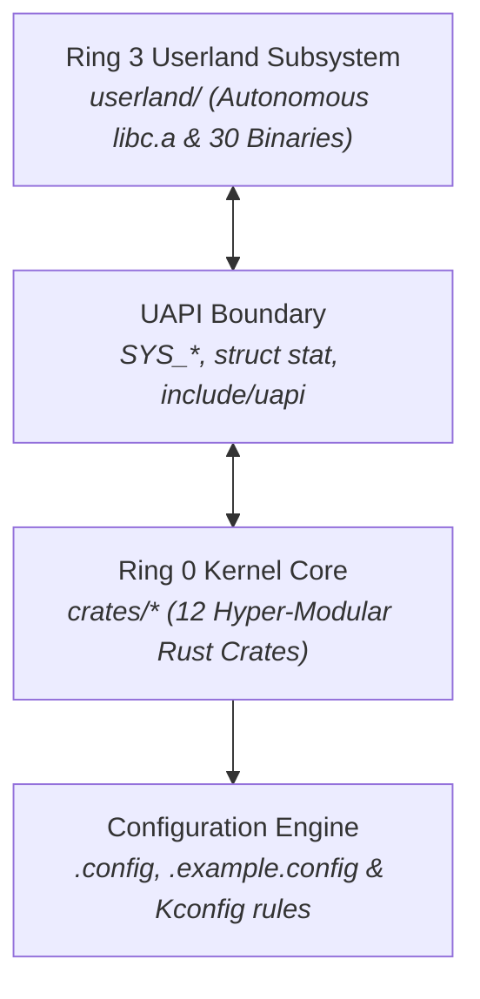

<!-- SPDX-License-Identifier: GPL-2.0-only -->

# Keira Architecture & System Design

The `architecture` domain defines the master system architecture, Torvalds-grade Ring 0/Ring 3 privilege demarcation, system call ABI boundaries and autonomous userland isolation.

---

## Subsystem Architecture

---

## Architecture Index

| Document | Focus Area | Description |
| :--- | :--- | :--- |
| [`uapi_boundary.md`](uapi_boundary.md) | Privilege Demarcation | Formal Ring 0 / Ring 3 privilege demarcation, system call calling conventions and UAPI header specifications |
| [`../journey/README.md`](../journey/README.md) | Engineering Journey | Complete chronological 34-milestone engineering journal from bare metal to v0.7.0 |
| [`../../userland/Makefile`](../../userland/Makefile) | Autonomous Build System | Standalone userland Makefile managing libc.a and 30 core utility binaries |
| [`../../.example.config`](../../.example.config) | Configuration Template | Reference template for Linux-style kernel build configuration |
