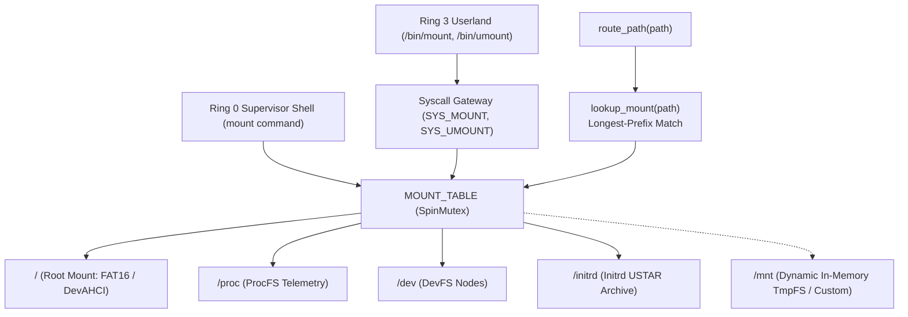

<!-- SPDX-License-Identifier: GPL-2.0-only -->

# VFS Dynamic Mount Table & Filesystem Registration

The Virtual Filesystem (VFS) mount subsystem manages dynamic attachment, detachment and resolution of filesystem drivers across the unified path namespace.

---

## 1. Mount Architecture



---

## 2. Dynamic Mount Table & Path Resolution

Keira resolves unified virtual paths through a dynamic *longest-prefix match* algorithm against active entries in `MOUNT_TABLE`:

```rust
use crate::vfs::types::FilesystemType;

/// Routes an absolute or relative path to its target filesystem type and relative sub-path.
pub fn route_path(path: &str) -> (&str, FilesystemType) {
    let resolved = resolve_alias_path(path);
    if resolved.starts_with('/') {
        crate::vfs::mount::lookup_mount(resolved)
    } else {
        if resolved == "proc" || resolved.starts_with("proc/") {
            let sub = resolved.strip_prefix("proc/").unwrap_or("");
            (sub, FilesystemType::Proc)
        } else if resolved == "dev" || resolved.starts_with("dev/") {
            let sub = resolved.strip_prefix("dev/").unwrap_or("");
            (sub, FilesystemType::Dev)
        } else if resolved == "initrd" || resolved.starts_with("initrd/") {
            let sub = resolved.strip_prefix("initrd/").unwrap_or("");
            (sub, FilesystemType::Initrd)
        } else {
            (resolved, FilesystemType::Fat)
        }
    }
}
```

---

## 3. Standard Boot Mount Configuration

At boot time, `MOUNT_TABLE` registers four default mount points:

1. `/`: Root storage filesystem (FAT16) on AHCI SATA block storage (`/dev/ahci0`).
2. `/proc`: Dynamic kernel metrics and process telemetry pseudo-filesystem (`procfs`).
3. `/dev`: Pseudo-filesystem exposing character and block devices (`devfs`).
4. `/initrd`: Read-only RAM disk archive containing boot payloads (`initrd`).

---

## 4. In-Memory Volatile TmpFS Filesystem

The kernel provides a built-in volatile memory filesystem (`FilesystemType::Tmpfs`) backed by a static `TmpfsNode` table:

- Supports runtime scratch file instantiation, directory creation, read, write and directory enumeration (`getdents`).
- All allocated nodes are automatically reclaimed upon unmount via `clear_all()`.

---

## 5. System Call Interface

- **`SYS_MOUNT (94)`**: Attaches a filesystem backend (`source`, `target`, `filesystemtype`, `mountflags`, `data`).
- **`SYS_UMOUNT (95)`**: Detaches an active mount point with busy-state and root-filesystem protection.
