<!-- SPDX-License-Identifier: GPL-2.0-only -->

# The Keira Learning Journey

The Keira project is conceived as an exploratory systems programming journey—building an entire freestanding monolithic kernel from scratch on bare silicon to a native Ring 3 C toolchain and hardened multi-architecture operating environment.

---

## Architecture Milestone Timeline

```mermaid
graph TD
    M1["1. Bootstrap & Hardware Bringup<br/><i>Multiboot2, GDT, IDT, APIC, SMP Trampoline</i>"] --> M2["2. Memory & Virtual Paging<br/><i>PMM Bitmap, 4-Level VMM, Heap, Swap</i>"]
    M2 --> M3["3. Multitasking & Scheduling<br/><i>Preemptive Round-Robin, Context Switch, cgroups, Signals</i>"]
    M3 --> M4["4. Storage & Filesystems<br/><i>AHCI, NVMe, VFS, EXT4, FAT16, USTAR Initrd</i>"]
    M4 --> M5["5. Bare-Metal Networking<br/><i>e1000 DMA, ARP, IPv4, TCP Stack, TLS 1.3</i>"]
    M5 --> M6["6. Userland & C Compiler<br/><i>Ring 3 Isolation, Syscalls, libc.a, Native KCC Compiler</i>"]
    M6 --> M7["7. Security Enclaves & eBPF<br/><i>TPM 2.0 MMIO, eBPF VM, Seccomp, MAC, io_uring</i>"]
    M7 --> M8["8. Modular Network Fetch Engine<br/><i>Chunked Streaming, Progress Bars, Netfilter Firewall</i>"]
    M8 --> M9["9. Dual Architecture & v0.5.0 Hardening<br/><i>x86_64 & i686 Parity, 81 Syscalls, Syzkaller-Lite Fuzzing</i>"]
    M9 --> M10["10. Raw Kernel Primitives<br/><i>Type-Safe EBR, Frame Refcounting, Copy-on-Write Fork</i>"]
    M10 --> M11["11. Work-Stealing Scheduling<br/><i>Per-CPU Runqueues, Chase-Lev Deques, Lock-Free Stealing</i>"]
    M11 --> M12["12. Hierarchical Magazine Slab Allocator<br/><i>Per-CPU Depots, Zero-Lock Caching, Bonwick Magazines</i>"]
    M12 --> M13["13. SMP IPI & TLB Shootdown<br/><i>Local APIC ICR Delivery, Multi-Core Rendezvous, Invalidation</i>"]
    M13 --> M14["14. SMP Reschedule IPI<br/><i>Vector 0xFE, Cross-Core Preemption, Low-Latency Dispatch</i>"]
    M14 --> M15["15. Userland Multi-Threading & v0.6.0 Release<br/><i>clone Syscall, CLONE_VM, Thread Groups, POSIX Pthreads</i>"]
    M15 --> M16["16. Canonical UNIX FHS & Root Control Plane<br/><i>FHS Namespace, Root Prompt keira:/#, Pure Ring 0</i>"]
    M16 --> M17["17. Unified Page Cache & Buffer Management<br/><i>4 KiB Page Cache, Dirty Tracking, VFS/PMM Integration</i>"]
    M17 --> M18["18. Linux-Grade Loopback lo Interface & Sockets<br/><i>127.0.0.1/8, In-Memory Zero-Copy Reflection, 65536 MTU</i>"]
    M18 --> M19["19. Pure Kernel Architecture & Canonical Userspace Init<br/><i>OS String Purge, PID 1 Ring 3 Init, keira-kernel.org</i>"]
    M19 --> M20["20. Standalone Userspace Shell & Direct PATH Execution<br/><i>Ring 3 /bin/sh.elf, $PATH Resolution, Linux Parity</i>"]
    M20 --> M21["21. Canonical Shell Script Execution & Kernel Shebang Support<br/><i>Shebang (#!), /bin/sh Runner, Direct .sh Invocation, /etc/init.sh</i>"]
    M21 --> M22["22. Pure Kernel Slimming & Ring 3 Shell Maturity<br/><i>Pipelines, I/O Redirection, /bin/cat, /bin/ls, UNIX Parity</i>"]
    M22 --> M23["23. Pure Kernel Slimming Fase 2 & Userspace Network Client<br/><i>In-Kernel kcc Removal, /bin/fetch.elf, Supervisor Hardware Diagnostic Monitor</i>"]
    M23 --> M24["24. Pure Kernel Demarcation & Complete Userspace Coreutils<br/><i>/bin/ps, /bin/kill, /bin/hostname, /bin/clear, /bin/dmesg, /bin/df, BSD/Linux Model</i>"]
    M24 --> M25["25. Network Diagnostic Toolset & ProcFS Telemetry<br/><i>/bin/ping, /bin/ifconfig, /bin/uname, /proc/net/dev, SYS_PING</i>"]
    M25 --> M26["26. In-Kernel Routing Engine FIB & ProcFS Network Telemetry<br/><i>FIB Longest Prefix Match, /proc/net/route, /proc/net/arp, /proc/net/tcp, /bin/route, /bin/arp</i>"]
    M26 --> M27["27. Kernel Socket Telemetry Subsystem & Netstat Utility<br/><i>/proc/net/udp, /proc/net/raw, /proc/net/sockstat, /bin/netstat, Socket Observability</i>"]
    M27 --> M28["28. Kernel Netfilter Firewall Subsystem & Iptables Utility<br/><i>/proc/net/ip_tables_names, /proc/net/stat/nf_conntrack, /proc/net/iptables, /bin/iptables</i>"]
    M28 --> M29["29. Bare-Metal Freestanding Purity & Canonical Numerical Credential Model<br/><i>Distro Database Purge, Freestanding Identity Engine, Zero-Stub Telemetry</i>"]
    M29 --> M30["30. POSIX Multi-User Security & Session Management<br/><i>SYS_GETEUID (90), SYS_GETEGID (91), Credential Inheritance, /bin/whoami, /bin/id, /bin/su</i>"]
    M30 --> M31["31. Distro Bloat Eradication & Pure Rootfs Architecture<br/><i>Libc Source Tree Purge, Canonical /lib/libc.a, 100% Zero-Stub Verification</i>"]
    M31 --> M32["32. VFS Symbolic Links & Freestanding Link Utility<br/><i>SYS_SYMLINK (92), SYS_READLINK (93), In-Kernel Symlink Table, /bin/ln (-s)</i>"]
    M32 --> M33["33. Modular Userland Decoupling & Pure Ring 0 Kernel<br/><i>USERLAND=0/1 Flag, make kernel, make kernel-iso, make run-bare</i>"]
    M33 --> M34["34. Torvalds-Grade Pure Kernel Demarcation & Autonomous Userland<br/><i>userland/Makefile, .config, make defconfig, make headers_install</i>"]
    M34 --> M35["35. Dynamic VFS Mount Subsystem<br/><i>TmpFS, SYS_MOUNT/SYS_UMOUNT, /bin/mount, /bin/umount</i>"]
    M35 --> M36["36. Dynamic Anonymous Pipe Subsystem & POSIX Stream Pipelines<br/><i>PIPE_TABLE, SYS_PIPE2 (96), Broken Pipe SIGPIPE, /bin/sh Streaming, /bin/test_pipe</i>"]
```

---

## Milestone Chapters

### Archived Milestones (v0.1.0 to v0.6.0)

Foundational development milestones (Milestones 1 through 15) are consolidated and preserved in the [Historical Milestones Archive (`archive_v010_v060.md`)](archive_v010_v060.md).

| Milestone | Chapter Document | Target Version | Primary Focus Areas |
| :--- | :--- | :--- | :--- |
| **Milestones 1–15** | [`archive_v010_v060.md`](archive_v010_v060.md) | `v0.1.0`–`v0.6.0` | Bare-metal bootstrap, paging, multitasking, storage, networking, KCC compiler, TPM 2.0, eBPF, work-stealing, slab allocator, SMP IPI, TLB shootdown and multithreading |

### Active v0.7.0 Milestones

| Milestone | Chapter Document | Target Version | Primary Focus Areas |
| :--- | :--- | :--- | :--- |
| **Milestone 16** | [`canonical_fhs_v070.md`](canonical_fhs_v070.md) | `v0.7.0` | Canonical UNIX FHS namespace, removal of legacy prefixes and root prompt `keira:/# ` |
| **Milestone 17** | [`page_cache_v070.md`](page_cache_v070.md) | `v0.7.0` | 4 KiB unified page cache, dynamic buffer management, dirty page writeback and telemetry |
| **Milestone 18** | [`loopback_v070.md`](loopback_v070.md) | `v0.7.0` | Linux-grade loopback (`lo`) adapter, 127.0.0.1/8 local IPC reflection and zero-NIC socket routing |
| **Milestone 19** | [`pure_kernel_v070.md`](pure_kernel_v070.md) | `v0.7.0` | Pure freestanding Ring 0 kernel architecture, complete OS purge, canonical userspace init (PID 1) and supervisor handover |
| **Milestone 20** | [`sh_userspace_v070.md`](sh_userspace_v070.md) | `v0.7.0` | Standalone Ring 3 POSIX shell (`/bin/sh.elf`), direct supervisor `$PATH` execution, multi-token `-c` string parsing and userspace parity |
| **Milestone 21** | [`script_shebang_v070.md`](script_shebang_v070.md) | `v0.7.0` | Canonical shell script execution, kernel shebang (`#!`) interpreter recognition, userspace script runner and `/etc/init.sh` system bootstrap |
| **Milestone 22** | [`unix_parity_v070.md`](unix_parity_v070.md) | `v0.7.0` | Pure kernel slimming, Ring 3 shell maturity (redirection, pipes, chaining), /bin/cat.elf, /bin/ls.elf and UNIX parity |
| **Milestone 23** | [`kernel_slimming_v070.md`](kernel_slimming_v070.md) | `v0.7.0` | In-kernel compiler elimination, freestanding Ring 3 `/bin/fetch.elf`, supervisor diagnostic monitor and TTY/FAT fixes |
| **Milestone 24** | [`pure_coreutils_v070.md`](pure_coreutils_v070.md) | `v0.7.0` | Pure kernel demarcation, complete userspace coreutils (/bin/ps, /bin/kill, /bin/hostname, /bin/clear, /bin/dmesg, /bin/df) and emergency debugger slimming |
| **Milestone 25** | [`network_userland_v070.md`](network_userland_v070.md) | `v0.7.0` | Network diagnostic toolset (/bin/ping, /bin/ifconfig, /bin/uname), /proc/net/dev virtual telemetry and Vector 89 SYS_PING |
| **Milestone 26** | [`kernel_routing_v070.md`](kernel_routing_v070.md) | `v0.7.0` | In-Kernel routing engine FIB, ProcFS network telemetry (/proc/net/route, /proc/net/arp, /proc/net/tcp) and core utilities (/bin/route, /bin/arp) |
| **Milestone 27** | [`kernel_socket_telemetry_v070.md`](kernel_socket_telemetry_v070.md) | `v0.7.0` | Kernel socket telemetry subsystem, ProcFS virtual inspection (/proc/net/udp, /proc/net/raw, /proc/net/sockstat) and core utility (/bin/netstat) |
| **Milestone 28** | [`kernel_firewall_v070.md`](kernel_firewall_v070.md) | `v0.7.0` | In-kernel Netfilter firewall subsystem, ProcFS telemetry (/proc/net/ip_tables_names, /proc/net/stat/nf_conntrack, /proc/net/iptables) and core utility (/bin/iptables) |
| **Milestone 29** | [`pure_telemetry_v070.md`](pure_telemetry_v070.md) | `v0.7.0` | Bare-metal freestanding purity, complete eradication of distro databases and pure numerical credential model |
| **Milestone 30** | [`multiuser_security_v070.md`](multiuser_security_v070.md) | `v0.7.0` | POSIX multi-user security, kernel credential subsystem (SYS_GETEUID, SYS_GETEGID), credential inheritance and core utilities (/bin/whoami, /bin/id, /bin/su) |
| **Milestone 31** | [`distro_purge_v070.md`](distro_purge_v070.md) | `v0.7.0` | Distro bloat eradication, rootfs C source tree purge, canonical `/lib/libc.a` and full hardware verification |
| **Milestone 32** | [`vfs_symlink_v070.md`](vfs_symlink_v070.md) | `v0.7.0` | VFS symbolic links, kernel registry, SYS_SYMLINK/SYS_READLINK, transparent path dereferencing and freestanding `/bin/ln` |
| **Milestone 33** | [`kernel_decoupling_v070.md`](kernel_decoupling_v070.md) | `v0.7.0` | Modular userland decoupling, USERLAND=0/1 build flag, pure kernel ISO, make run-bare and freestanding Ring 0 supervisor console |
| **Milestone 34** | [`kernel_demarcation_v070.md`](kernel_demarcation_v070.md) | `v0.7.0` | Torvalds-grade pure kernel demarcation, autonomous userland build system, .config engine and make headers_install |
| **Milestone 35** | [`vfs_mount_v070.md`](vfs_mount_v070.md) | `v0.7.0` | Dynamic VFS mount subsystem, in-memory TmpFS, SYS_MOUNT/SYS_UMOUNT syscalls, /bin/mount, /bin/umount and Ring 0 supervisor console mount command |
| **Milestone 36** | [`pipe_subsystem_v070.md`](pipe_subsystem_v070.md) | `v0.7.0` | Dynamic anonymous pipe subsystem, PIPE_TABLE (32 channels), SYS_PIPE2 (96), broken pipe SIGPIPE, /bin/sh streaming pipelines and /bin/test_pipe |

---

## Core Engineering Principles

Throughout all milestones, Keira enforces five fundamental invariants:

1. **Pure Freestanding Architecture (`#![no_std]`)**: Zero host operating system libraries, zero foreign runtime bloat and pure memory management from first principles.
2. **Defensive Kernel Programming**: Complete absence of `unwrap()` and `panic!` calls in kernel-space runtime paths, relying on explicit `Result<T, &'static str>` or custom error enums.
3. **Symmetrical Dual-Architecture Support**: Native support for modern 64-bit Long Mode (`x86_64`) and legacy 32-bit Protected Mode (`i686`) across all core subsystems.
4. **Hardware Verification First**: Every feature is rigorously verified against real and simulated silicon via automated multi-architecture QEMU test harnesses.
5. **Austere Console Palette**: Strictly compliant with the standard monochrome console standard (`White`, `LightGrey`, `LightGreen`, `Yellow`, `LightRed`).
