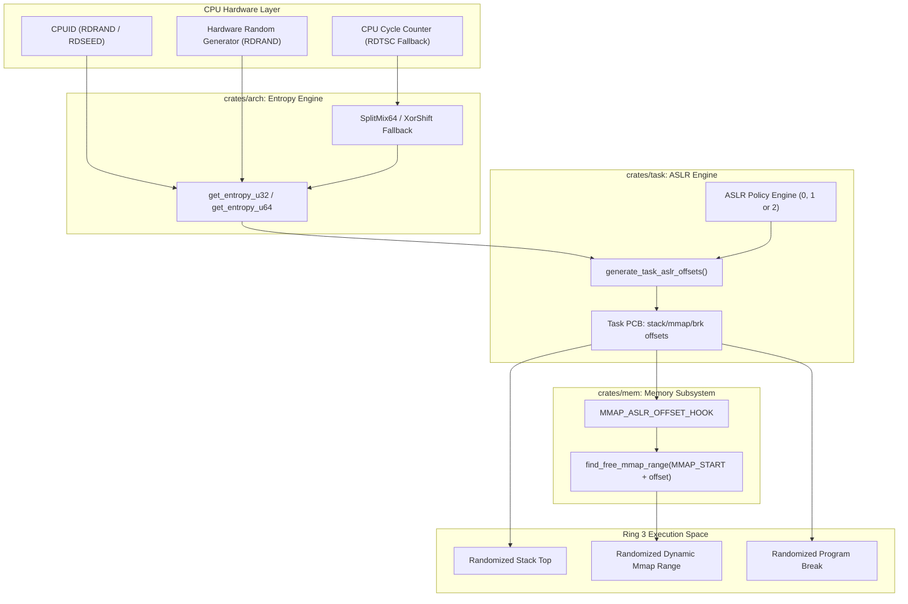

<!-- SPDX-License-Identifier: GPL-2.0-only -->

# Milestone 44: Kernel ASLR (KASLR) & Userland Address Space Randomization

## 1. Overview & Architectural Motivation

Milestone 44 introduces Address Space Layout Randomization (ASLR) and silicon-backed hardware entropy harvesting into the Keira Kernel. Operating in conjunction with the hardware W^X execution barriers established in Milestone 43, ASLR randomizes the virtual memory layout of processes, mitigating Return-Oriented Programming (ROP), buffer overflow hijacking and predictable memory probing attacks.

1. **Hardware Entropy Harvesting Subsystem (`crates/arch/src/cpu/entropy.rs`)**:
   - Inspects CPU capabilities via `CPUID` Leaf 1 (`ECX` bit 30) for `RDRAND` and Leaf 7 (`EBX` bit 18) for `RDSEED`.
   - Generates high-entropy random numbers directly from CPU hardware quantum thermal noise when available.
   - Provides deterministic high-speed fallback mixer using CPU Time-Stamp Counter (`rdtsc`) and SplitMix64 / XorShift algorithms when running on legacy or virtualized silicon without `RDRAND`.
2. **Three-Tier System ASLR Policy Engine (`crates/task/src/aslr/engine.rs`)**:
   - **Mode 0 (Disabled)**: Fixed deterministic addresses for debugging and predictable regression testing.
   - **Mode 1 (Conservative)**: Stack base randomization only.
   - **Mode 2 (Full - Default)**: Full randomization across user execution stack bases, dynamic `mmap` allocation regions and process heap (`brk` / `sbrk`) boundaries.
3. **Architectural Randomization Bounds**:
   - **64-bit (`x86_64`)**: Stack randomization (0..256 KiB, up to 64 pages), mmap allocation randomization (0..16 MiB, up to 4096 pages) and dynamic heap break randomization (0..128 KiB, up to 32 pages).
   - **32-bit (`i686`)**: Stack randomization (0..64 KiB, up to 16 pages), mmap allocation randomization (0..1 MiB, up to 256 pages) and dynamic heap break randomization (0..32 KiB, up to 8 pages).
4. **Linux-Standard ProcFS Reflection**:
   - Exposes `/proc/sys/kernel/randomize_va_space` reflecting the active system ASLR mode (`2\n`).
5. **Supervisor Command Suite Integration**:
   - Adds `aslrinfo` (alias `aslr`) to the Ring 0 diagnostic console.
   - Supports inspecting hardware entropy sources, active policy modes and architectural limits.
   - Supports `-v` (verbose) to display per-task randomized memory layout tables (PID, comm, stack offset, mmap offset and brk offset).
   - Supports runtime policy reconfiguration (`aslrinfo 0`, `aslrinfo 1`, `aslrinfo 2`).

---

## 2. Technical Architecture & Component Interaction



---

## 3. Implementation Details

### A. Hardware Entropy Harvesting (`crates/arch/src/cpu/entropy.rs`)
The architecture layer queries CPUID feature flags during early hardware bringup:
- `CPUID(0x00000001).ECX`: Tests bit 30 for `RDRAND`.
- `CPUID(0x00000007, 0x00).EBX`: Tests bit 18 for `RDSEED`.

When `RDRAND` is supported, entropy generation executes hardware instructions:
- On `x86_64`: `rdrand rax` with carry flag retry loops.
- On `i686`: `rdrand eax` with carry flag retry loops.

When running on virtual machines or CPUs without silicon RNG, `get_entropy_fallback()` harvests high-resolution cycle jitter from `rdtsc` and passes the seed through a freestanding SplitMix64 mixing function.

### B. ASLR Engine & Offset Generation (`crates/task/src/aslr/engine.rs`)
Address offsets are generated per process during initial spawn and binary execution (`execve`), ensuring all offsets align to physical page boundaries (4096 bytes):
- **Stack Offset**: Up to 64 pages (256 KiB) subtracted from the canonical user stack ceiling (`0x00007FFFFFFFE000` on x86_64).
- **Mmap Offset**: Up to 4096 pages (16 MiB) added to the base mmap allocation window (`0x0000700000000000` on x86_64).
- **Heap Break Offset**: Up to 32 pages (128 KiB) added to the initial user heap break (`USER_DEFAULT_BRK`).

### C. CoW Coherence & Fork Semantics (`crates/task/src/scheduler/process/clone.rs`)
In accordance with UNIX standards:
- `fork()` and `clone()` duplicate the parent memory layout, retaining identical ASLR offsets so Copy-on-Write and shared memory mappings remain valid.
- `execve()` and fresh user process launches generate fresh randomized offsets from the hardware entropy engine.

### D. ProcFS Virtual Node (`crates/fs/src/proc/system/aslr.rs`)
Exposes `/proc/sys/kernel/randomize_va_space` reflecting the active system policy. Reading the node returns `"2\n"`, `"1\n"` or `"0\n"` matching Linux kernel conventions.

### E. Ring 0 Supervisor `aslrinfo` Command (`crates/shell/src/cmds/sys/info/aslrinfo.rs`)
Enables kernel administrators to inspect and reconfigure ASLR settings from the supervisor console:
```text
Address Space Layout Randomization (ASLR) Subsystem:
  Policy Mode:       [FULL]         Mode 2 (Stack, mmap and brk randomization)
  Hardware Entropy:  [HARDWARE]     CPU RDRAND
  ProcFS Reflection: /proc/sys/kernel/randomize_va_space
  Architectural Bounds:
    Stack Range:     0..256 KiB (64 pages)
    Mmap Range:      0..16 MiB (4096 pages)
    Heap (Brk) Range:0..128 KiB (32 pages)
```

With `-v` (`--verbose`), displays the active task memory randomization table:
```text
  Active Task Address Space Randomization:
    PID   COMM             STACK OFFSET  MMAP OFFSET   BRK OFFSET
    0     kernel_shell     0x0           0x0           0x0
    1     sh.elf           0x1b000       0x420000      0x8000
```
