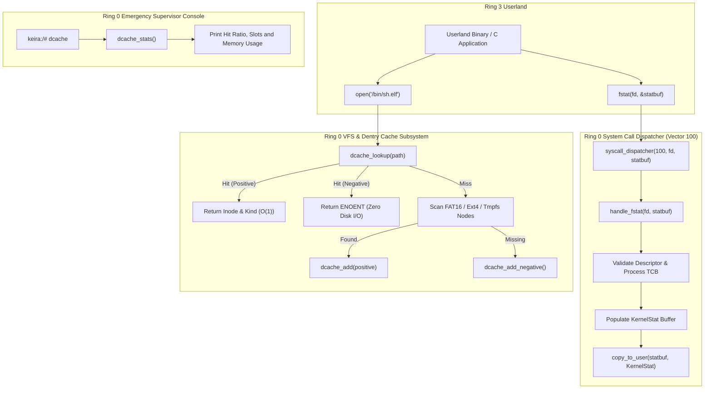

<!-- SPDX-License-Identifier: GPL-2.0-only -->

# Milestone 39: Pure Kernel VFS Dentry Cache (dcache) & Century Milestone Syscall 100 (SYS_FSTAT)

## 1. Overview & Architectural Motivation

Milestone 39 establishes two major milestones in Keira's progression as a freestanding monolithic kernel in Ring 0, operating strictly in accordance with pure kernel engineering principles and zero distribution bloat:

1. **VFS In-Memory Dentry Cache (`dcache`)**:
   - Modeled after the Linux kernel's `fs/dcache.c`, this subsystem accelerates path resolution from repeated $O(N)$ storage extent scans to instantaneous $O(1)$ fast-path in-memory hash table lookups.
   - Includes positive caching, negative dentry caching to prevent wasted disk I/O on missing paths, second-chance LRU eviction and automatic prefix invalidation on directory and file mutations.
2. **Century Milestone: System Call 100 (`SYS_FSTAT`)**:
   - Keira achieves exactly 100 registered system call vectors with the introduction of canonical POSIX `fstat(int fd, struct stat *statbuf)` on Vector 100.
   - Complements Vector 99 (`SYS_STAT`) by allowing Ring 3 processes to query metadata directly from open file descriptors, anonymous pipes, sockets and character devices.
3. **Supervisor Telemetry & Observability (`dcache`)**:
   - Integrates the `dcache` command into the Ring 0 emergency supervisor shell, reporting real-time hit ratios, active positive and negative entry counts, LRU evictions and memory footprint.

---

## 2. Technical Architecture & Component Interaction

---

## 3. Implementation Details

### VFS Dentry Cache Engine (`crates/fs/src/cache/dentry.rs`)
- `DENTRY_CACHE_CAPACITY`: 64 resident dentry slots.
- `DENTRY_PATH_MAX`: 96 bytes canonical path capacity.
- `dcache_lookup(path)`: FNV-1a 32-bit hash lookup returning positive or negative outcomes.
- `dcache_add(path, is_dir, size, fs_type, inode)`: Inserts positive dentry with LRU eviction.
- `dcache_add_negative(path)`: Records missing paths to short-circuit future queries.
- `dcache_invalidate(path)`: Recursively purges path and descendant sub-paths upon writes and deletions.

### Century Syscall 100 (`SYS_FSTAT`)
- Registered in `crates/syscall/src/table/numbers/io.rs`: `pub const SYS_FSTAT: u64 = 100;`.
- Implemented in `crates/syscall/src/dispatcher/handlers/fs.rs`: `handle_fstat(arg1, arg2)`.
- Dispatched via `crates/syscall/src/dispatcher/router/entry.rs`: Vector 100.
- C standard library wrapper in `userland/lib/stat/query/stat.c` invoking `sys_fstat()`.
- Validated via userland test harness `userland/bin/test_abi/fs/tests.c` (Section 38).

### Ring 0 Supervisor Telemetry (`crates/shell/src/cmds/fs/mount/dcache.rs`)
- `dcache` command displaying total slots, active positive and negative dentries, cache hits, misses, LRU evictions and lookup hit ratio percentage.
- Supports `-c` or `--clear` flag to manually flush cached entries for debugging.

---

## 4. Dual-Architecture & Zero-Warning Compliance

Milestone 39 enforces all repository invariants across both bare-metal targets:
- **x86_64 Long Mode**: Boots hardware, executes Century Syscall 100 in Ring 3, passes unit and integration tests, executes network downloads and native C compiler builds without errors.
- **i686 Protected Mode**: Boots pure 32-bit hardware, passes dual-architecture compilation and headless smoke tests.
- **Zero Warnings Standard**: Clean execution of `make format`, `make lint`, `make test-unit`, `make full` and `make test-all`.
