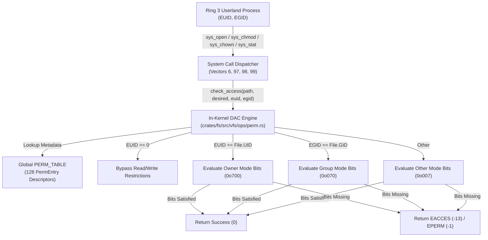

<!-- SPDX-License-Identifier: GPL-2.0-only -->

# Milestone 38: POSIX Discretionary Access Control (DAC), File Permissions, Ownership and Real Stat Metadata

## Overview

Milestone 38 advances Keira Kernel towards the `v0.7.0` release by introducing a full in-kernel POSIX Discretionary Access Control (DAC) security engine, kernel-level file permission and ownership registries, real metadata tracking via `stat` and two essential Ring 3 core utilities (`/bin/chmod` and `/bin/chown`). This milestone expands the canonical userland utility suite to **41 native ELF binaries** and brings the registered system call table up to 99 vectors.

Prior to Milestone 38, file permissions and ownership were evaluated strictly under coarse Mandatory Access Control (MAC) sandboxing, while file attribute queries (`stat`) returned hardcoded placeholder values. Milestone 38 implements true POSIX multi-user DAC semantics: files track numerical owner UID, group GID and mode bitmasks, allowing privileged superusers and file owners to restrict read, write and execute privileges across User, Group and Others classes.

Key accomplishments of Milestone 38 include:

1. **In-Kernel Permission and Ownership Registry (`crates/fs/src/vfs/ops/perm.rs`)**:
   - Designed and implemented `PERM_TABLE`, a synchronized global table tracking up to 128 active file permission and ownership descriptors.
   - Implemented `set_permissions(path, mode)` and `set_ownership(path, uid, gid)` with canonical path sanitization.
   - Implemented `get_metadata(path)` providing default canonical heuristics (e.g. `/tmp` with `0o1777`, `/bin/` with `0o755`, `/dev/` character devices with `0o666` and standard files with `0o644`) alongside active override entries.
   - Implemented `check_access(path, desired_access, current_euid, current_egid)` enforcing standard POSIX DAC rules:
     - Root user (EUID 0) bypasses read and write access restrictions.
     - Owner class permissions apply when caller EUID matches file UID.
     - Group class permissions apply when caller EGID matches file GID.
     - Others class permissions apply to all other identities.

2. **System Call Infrastructure and Dispatching (`crates/syscall`)**:
   - Registered three new POSIX system call vectors:
     - Vector 97: `SYS_CHMOD` (`handle_chmod`)
     - Vector 98: `SYS_CHOWN` (`handle_chown`)
     - Vector 99: `SYS_STAT` (`handle_stat`)
   - Implemented `KernelStat`, an 88-byte `#[repr(C)]` binary layout mirroring userland C `struct stat` for ABI compatibility.
   - Enforced DAC permission validation in `handle_open` for all existing file access requests and initialized creator credentials on new files.
   - Integrated execute DAC permission validation in `handle_exec` to reject execution of files lacking `X_OK`.
   - Wired router dispatch and validated user copying with comprehensive unit tests across both 32-bit and 64-bit architectures.

3. **Freestanding C Library Integration (`userland/lib/` and `userland/include/`)**:
   - Defined `SYS_CHMOD`, `SYS_CHOWN` and `SYS_STAT` in `<sys/syscall.h>`.
   - Implemented raw system call wrappers `sys_chmod`, `sys_chown` and `sys_stat` in `userland/lib/syscall/fs/file.c`.
   - Replaced dummy stubs in `userland/lib/stat/mode/chmod.c` and `userland/lib/stat/query/stat.c` with live system call invocations and standard errno translation.
   - Created `userland/lib/unistd/fs/chown.c` providing the POSIX `chown()` function.
   - Added `S_ISLNK`, `S_ISFIFO` and `S_ISSOCK` macros to `<sys/stat.h>`.

4. **New Ring 3 Core Utilities (`/bin/chmod` and `/bin/chown`)**:
   - `/bin/chmod.elf` (`/bin/chmod`): Freestanding mode modification utility supporting octal formats (`755`, `644`, `600`), symbolic clauses (`+x`, `-w`, `u+rwx`, `go-w`), verbose diagnostics (`-v`) and recursive directory traversal (`-R`).
   - `/bin/chown.elf` (`/bin/chown`): Freestanding ownership assignment utility supporting `owner:group`, `owner`, `:group`, numeric IDs and `root` aliases with recursive directory traversal (`-R`).
   - Updated `/bin/ls.elf` (`/bin/ls`) to invoke `stat()` in long listing mode (`ls -l`), rendering exact mode bit strings (`-rwxr-xr-x`, `-rw-------`), link count, owner UID, group GID and file size.
   - Updated `/bin/sh.elf` (`builtin_help`) to index all 41 core utilities.

---

## Architectural Data Flow: POSIX DAC Security Model

---

## Technical Specifications

- **Kernel Crates Modified**: `crates/fs`, `crates/syscall`
- **Userland Components Added**: `userland/bin/chmod/main.c`, `userland/bin/chown/main.c`, `userland/lib/unistd/fs/chown.c`
- **Userland Components Updated**: `userland/bin/ls/main.c`, `userland/bin/sh/main.c`, `userland/lib/stat/mode/chmod.c`, `userland/lib/stat/query/stat.c`, `userland/lib/syscall/fs/file.c`, `userland/include/sys/stat.h`, `userland/include/sys/syscall.h`, `userland/include/unistd.h`, `userland/Makefile`
- **Total Registered System Calls**: 99 system call vectors
- **Total Userland Core Utilities**: 41 native ELF executables
- **Hardware Architecture Parity**: 100% verified on both `x86_64` and `i686`
