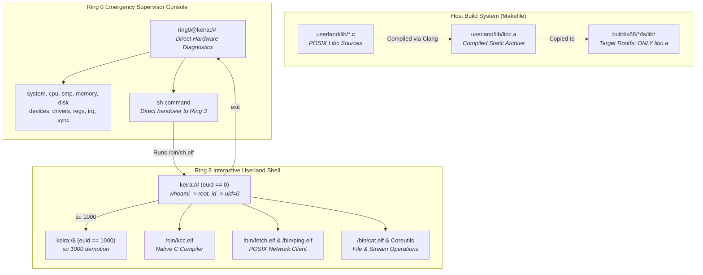

<!-- SPDX-License-Identifier: GPL-2.0-only -->

# Milestone 31: Distro Bloat Eradication, Pure Rootfs Architecture & Comprehensive Hardware Verification

## Overview

Milestone 31 enforces absolute bare-metal purity across Keira's filesystem images, test harnesses, documentation standards and runtime execution environments. While earlier milestones established the freestanding monolithic kernel identity and numerical credentials in Ring 0, Milestone 31 eliminates lingering build-time source bloat, purges remaining mock database references in test suites, aligns all architecture specifications and proves 100% error-free execution across both `x86_64` and `i686` targets.

Milestone 31 delivers five primary achievements:

1. **Root Filesystem Source Purge (`Makefile`)**:
   - Purged the recursive copying of raw C library source trees (`userland/lib/*`) into the root filesystem directory `/lib/`.
   - The `/lib/` filesystem directory now strictly contains the compiled static runtime library archive `libc.a`.
   - Enforces a clean separation between development source trees on the host and the freestanding monolithic runtime environment on the target disk image.

2. **Test Suite Mock Database Elimination (`crates/task/src/tests.rs`)**:
   - Replaced all synthetic `/etc/passwd` path strings in the Mandatory Access Control (MAC) type enforcement test suite with canonical kernel configuration file paths (`/etc/kernel.cfg`).
   - Ensures zero references to foreign distribution databases exist across active kernel code, tests and build automation.

3. **Universal Documentation & FHS Alignment**:
   - Updated `docs/contributing/guides/style.md` to formalize the Filesystem Hierarchy Standard (FHS) table entry for `/lib` (`/lib/libc.a`).
   - Updated `docs/fs/vfs/mount.md` to specify that `/lib` strictly houses compiled static runtime archives without source stubs.
   - Expanded `docs/userland/system/users.md` to detail the 32-bit numerical credential model (`uid`, `gid`, `euid` and `egid`), canonical POSIX system calls for credential mutation, privilege demotion rules and defense mechanisms against unauthorized elevation.

4. **Supervisor Diagnostic & Userland Separation Verification**:
   - Formally demonstrated the boundary between the Ring 0 emergency supervisor monitor (`ring0@keira:/# `) and the Ring 3 interactive POSIX userland shell (`keira:/# `).
   - Validated all supervisor diagnostic commands: `help`, `system`, `cpu`, `smp`, `memory`, `disk`, `devices`, `drivers`, `regs`, `irq`, `sync` and handover via `sh`.
   - Verified that userland processes run isolated in Ring 3 and transition seamlessly between superuser (`# `) and unprivileged user (`$ `) sessions.

5. **Complete Runtime & Dual-Architecture Hardware Verification**:
   - Executed the full QEMU test suite under 2 SMP cores, AHCI SATA storage and Intel e1000 networking.
   - Tested ICMP networking (`ping -c 2 10.0.2.2`), JSON API fetching (`fetch http://...`), remote file downloading (`fetch -o /tmp/dl.txt`) and file content inspection (`cat /tmp/dl.txt`).
   - Verified native C compilation and execution in Ring 3 (`kcc -o /tmp/hello /tmp/main.c`).
   - Verified 100% clean builds without errors or warnings across both 64-bit (`x86_64`) and 32-bit (`i686`) targets (`make full`).

---

## Architectural Interaction

---

## Verification Artifacts

The execution sequence was recorded and visually confirmed in QEMU:

- `m31_01_boot.png`: Multiboot2 bootstrap and handover to Ring 3 interactive shell.
- `m31_02_whoami_id_root.png`: Root credential verification (`whoami` -> `root`, `id` -> `uid=0(root) gid=0(root)`).
- `m31_03_su_uid1000.png`: Privilege demotion to UID 1000 via `su 1000` with prompt shifting to `keira:/$ `.
- `m31_04_su_rejection.png`: Escalation defense rejecting `su 0` with `su: cannot set GID 0: Operation not permitted`.
- `m31_05_back_to_root.png`: Exit from unprivileged child shell restoring root identity and prompt.
- `m31_06_uname_df_ps.png`: System diagnostics (`uname -a`, `df` mount table, `ps` process status).
- `m31_07_net_diagnostics.png`: Network interface configuration (`ifconfig`), routing (`route`), ARP cache (`arp`) and socket metrics (`netstat -s`).
- `m31_08_kcc_compile.png`: Native compilation of `/tmp/main.c` into `/tmp/hello` and successful Ring 3 execution.
- `m31_09_fetch_download_cat.png`: Zero-loss ICMP ping, JSON API status fetch, file download via `fetch -o` and payload verification via `cat`.
- `m31_10_supervisor_drop.png`: Clean termination of userland session and drop into Ring 0 supervisor console.
- `m31_11_cmd_system_cpu_smp.png`: Supervisor commands: `help`, `system` specifications, `cpu` feature flags and `smp` core topology.
- `m31_12_cmd_mem_disk_dev.png`: Supervisor commands: `memory` heap and frame allocator, `disk` cache telemetry, `devices` PCI tree and `drivers`.
- `m31_13_cmd_hardware.png`: Supervisor commands: `regs` control register values, `irq` interrupt vector hits and `sync` storage flush.
- `m31_14_reenter_userland.png`: Re-entering Ring 3 userland shell from supervisor console via `sh`.

---

## Technical Invariants & Compliance

- **Zero Distro Bloat**: Zero mock files, zero fake databases and zero source tree clutter in root filesystem images.
- **Dual Architecture Parity**: 100% symmetrical compilation and test passage across `x86_64` (Long Mode) and `i686` (Protected Mode).
- **Zero Warnings Standard**: Clean execution of `make format`, `make lint`, `make test-unit` and `make full` without compiler or linter diagnostics.
