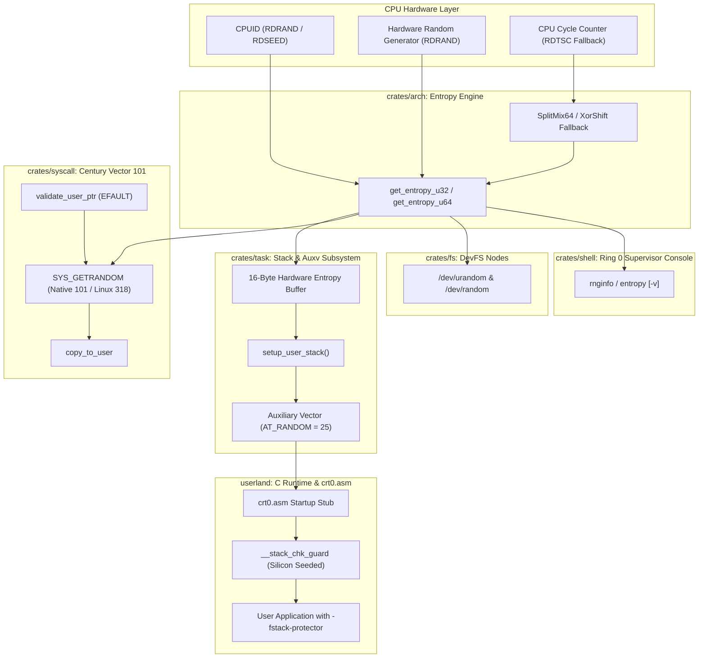

<!-- SPDX-License-Identifier: GPL-2.0-only -->

# Milestone 45: Dynamic Stack Canary & Cryptographic Hardware Entropy

## 1. Overview & Architectural Motivation

Milestone 45 introduces dynamic, silicon-seeded stack canary protection and direct hardware entropy syscall integration into the Keira Kernel. Operating in conjunction with the hardware W^X execution mitigations (Milestone 43) and Kernel Address Space Layout Randomization (Milestone 44), dynamic stack canaries prevent stack buffer overflow exploitation and Return-Oriented Programming (ROP) payloads from corrupting saved instruction pointers.

Prior to Milestone 45, userland stack protection relied on a compile-time static sentinel (`0x595e9fbd94fda766ULL`), which left processes vulnerable to brute-force or precomputed memory overwrite attacks once discovered. Milestone 45 resolves this security gap by integrating silicon hardware entropy into the process startup pipeline:

1. **Hardware Entropy Auxiliary Vector Seeding (`crates/task/src/stack/user/`)**:
   - During task execution stack initialization (`setup_user_stack`), the kernel harvests 16 bytes of true cryptographic hardware entropy via `keira_arch::cpu::get_entropy_u64()` (on `x86_64`) or `keira_arch::cpu::get_entropy_u32()` (on `i686`).
   - The 16 random bytes are written directly onto the user stack buffer and an auxiliary vector entry (`AT_RANDOM = 25`) is placed pointing directly to this silicon-generated entropy block.
2. **Dynamic Userland C Runtime Canary (`crt0.asm` & `libc.a`)**:
   - The userland entry point (`crt0.asm`) scans the process auxiliary vector table for `AT_RANDOM` (25).
   - Upon encountering `AT_RANDOM`, the entry code extracts the hardware entropy pointer and initializes the global runtime canary `__stack_chk_guard` before invoking `main()`.
   - Every process execution receives a unique, unpredictable 64-bit (or 32-bit) stack canary value directly from silicon hardware.
3. **Century Syscall 101: `SYS_GETRANDOM` (`crates/syscall`)**:
   - Implements native syscall vector 101 (`SYS_GETRANDOM`), with dual-routing support for Linux standard vector 318.
   - Enforces user memory pointer isolation via `validate_user_ptr` with `EFAULT` protection.
   - Restricts buffer requests to 32 MiB bounds with `EINVAL` protection.
   - Streams silicon hardware entropy safely into userland buffers using chunked copy routines (`copy_to_user`).
4. **Silicon-Backed Character Devices (`crates/fs`)**:
   - Upgrades `/dev/random` and `/dev/urandom` character device nodes in `crates/fs/src/dev/char/random.rs`.
   - Replaces makeshift cycle loops with direct chunked reads from `keira_arch::cpu::get_entropy_u32()`.
5. **Supervisor Command Suite Integration (`crates/shell`)**:
   - Adds `rnginfo` (alias `entropy`) to the Ring 0 diagnostic console.
   - Inspects active hardware entropy source (`RDRAND` silicon instruction or SplitMix64 cycle jitter mixer), entropy quality and kernel integration status (`AT_RANDOM`, `/dev/urandom` and Syscall 101).
   - Supports `-v` (verbose) flag to harvest and display a live 16-byte silicon entropy sample and CPU RNG feature flags (`RDRAND`, `RDSEED` and `RDTSC`).

---

## 2. Technical Architecture & Component Interaction



---

## 3. Implementation Details

### A. True Silicon Hardware Entropy Seeding for User Execution Stacks
In `crates/task/src/stack/user/amd64.rs` and `crates/task/src/stack/user/i386.rs`, the execution stack allocation routine creates a dedicated 16-byte random seed buffer:
- On `x86_64`: Two 64-bit entropy words are harvested via `keira_arch::cpu::get_entropy_u64()`.
- On `i686`: Four 32-bit entropy words are harvested via `keira_arch::cpu::get_entropy_u32()`.

The auxiliary vector table is positioned directly above the environment pointers on the user stack:
```rust
auxv_entries[auxv_idx] = (AT_RANDOM, rand_buf_user_ptr);
```

### B. Dynamic Userland C Runtime Canary Initialization
In `userland/arch/x86/x86_64/crt0.asm` and `userland/arch/x86/i686/crt0.asm`, the initial entry point traverses the auxiliary vector table looking for `AT_RANDOM` (type 25). Once found:
```nasm
.found_random:
    mov r10, [rdi+8]            ; Pointer to 16 bytes of hardware entropy
    mov r10, [r10]              ; Dereference 64-bit hardware entropy value
    mov [rel __stack_chk_guard], r10
```
This guarantees that `__stack_chk_guard` is seeded with true silicon entropy before any userland function executes.

### C. Century Syscall 101: `SYS_GETRANDOM`
Syscall 101 exposes cryptographic silicon entropy directly to Ring 3 applications without requiring filesystem descriptors:
- Vector 101 (Native) and Vector 318 (Linux x86_64 standard) are routed to `handle_getrandom(buf_ptr, buflen, flags)`.
- Validates user pointers via `validate_user_ptr(buf_ptr, buflen, true)`, returning `-EFAULT` on invalid addresses.
- Restricts single-call requests to 32 MiB, returning `-EINVAL` on excessive lengths.
- Transfers entropy in 64-byte chunks directly to user memory via `copy_to_user`.

### D. Userland C Library Support (`<sys/random.h>`)
Added standard headers and libc wrappers:
- `userland/include/sys/random.h`: Defines `GRND_NONBLOCK`, `GRND_RANDOM`, `GRND_INSECURE` and prototype `ssize_t getrandom(void *buf, size_t buflen, unsigned int flags);`.
- `userland/lib/syscall/sys/random.c`: Freestanding C wrapper invoking `syscall3(SYS_GETRANDOM, ...)`, managing `errno` translation.

### E. Ring 0 Supervisor `rnginfo` Command
Added `rnginfo` (alias: `entropy`) to `crates/shell/src/cmds/sys/info/rnginfo.rs`:
- Default invocation displays entropy hardware source, entropy quality level and kernel subsystem integration status.
- Verbose mode (`-v`) harvests and prints a live 16-byte silicon entropy sample and queries CPUID feature flags for `RDRAND`, `RDSEED` and `RDTSC`.

---

## 4. Verification & Quality Gates

Milestone 45 was validated across all required quality gates:
1. `make format`: 0 errors across Rust and C source trees.
2. `make lint`: 0 errors, 0 warnings across `clang-tidy` and `cargo clippy`.
3. `make test-unit`: All 49 `keira-shell`, 31 `keira-syscall`, 28 `keira-task` and core doc-tests passed cleanly.
4. `make full`: 100% clean release compilation for both `x86_64` and `i686` targets.
5. `make test-all`: Automated headless smoke tests passed on both architectures.
6. Live QEMU Runtime Verification:
   - Userland ABI Test 34 verified `SYS_GETRANDOM`, `/dev/urandom` and dynamic `__stack_chk_guard`.
   - Network subsystem verified ICMP ping, API status fetch and file download.
   - Native `kcc` compiler compiled and executed a C application under dynamic canary protection.
   - Shell pipelines and `/dev/urandom` verified in Ring 3.
   - Supervisor console command `rnginfo` and `rnginfo -v` verified in Ring 0.
