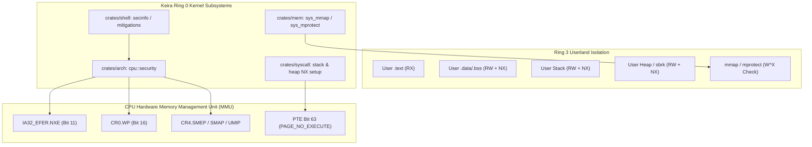

<!-- SPDX-License-Identifier: GPL-2.0-only -->

# Milestone 43: Hardware W^X & Kernel Exploit Mitigations

## 1. Overview & Architectural Motivation

Milestone 43 introduces foundational hardware exploit mitigations and strict W^X (Write XOR Execute) memory protection into the Keira Kernel. As Keira transitions into a multi-user, multi-process operating environment with dynamic networking and native compilation, enforcing hardware memory permission boundaries is paramount to preventing code injection, Return-to-User (ret2usr) attacks and unauthorized control-register mutations.

1. **Hardware W^X (Write XOR Execute) Memory Boundary**:
   - Every virtual memory page mapped in userland and kernel address spaces strictly adheres to the invariant: a page can be writable or executable, but never both simultaneously (`W ^ X`).
   - Rejection of simultaneous `PROT_WRITE | PROT_EXEC` across `mmap` (Syscall 20) and `mprotect` (Syscall 31) with POSIX `EINVAL` / `ENOMEM`.
   - Executable user text segments (`.text`) mapped strictly as Read-Only Executable (`RX`).
   - User data, BSS, execution stack and dynamic process heap (`sbrk` / `brk`) mapped strictly as Read-Write No-Execute (`RW + NX`).
2. **Silicon-Level Exploit Mitigations**:
   - **CR0.WP (Write Protect - bit 16)**: Enforces supervisor write-protection, preventing Ring 0 kernel code from accidentally or maliciously overwriting read-only user and kernel pages.
   - **IA32_EFER.NXE (No-Execute Enable - bit 11)**: Activates hardware page-table bit 63 (`PAGE_NO_EXECUTE`), enabling the CPU Memory Management Unit (MMU) to trap any execution attempts on stack and heap pages into `#PF` (Page Fault) exceptions.
   - **CR4.SMEP (Supervisor Mode Execution Prevention - bit 20)**: Detects and enables silicon-level blocking of Ring 0 kernel execution from user-space virtual addresses.
   - **CR4.SMAP (Supervisor Mode Access Prevention - bit 21)**: Detects and configures hardware restrictions preventing supervisor read/write access to user memory outside sanctioned user-copy windows.
   - **CR4.UMIP (User-Mode Instruction Prevention - bit 11)**: Detects and activates silicon traps for userland execution of sensitive instructions (`SGDT`, `SIDT`, `SLDT`, `SMSW`, `STR`).
3. **Supervisor Mitigation & Security Inspector (`secinfo`)**:
   - Adds the `secinfo` (alias `mitigations`) supervisor command to the emergency debugger console.
   - Renders active hardware CPU mitigations, memory boundary permissions and virtual memory fault telemetry (`#PF`, CoW duplications, access violation traps).

---

## 2. Technical Architecture & Component Interaction

---

## 3. Implementation Details

### A. CPU Security Feature Detection & Enablement (`crates/arch/src/cpu/security.rs`)
The architecture layer provides freestanding feature detection using standard x86 `CPUID` instruction queries:
- `CPUID(0x80000001).EDX`: Tests bit 20 for IA32_EFER NX/DEP support.
- `CPUID(0x00000007, 0x00).EBX`: Tests bit 7 (SMEP) and bit 20 (SMAP).
- `CPUID(0x00000007, 0x00).ECX`: Tests bit 2 (UMIP).

During early kernel architecture initialization (`crates/arch/src/init/sequence.rs`), `enable_hardware_mitigations()` executes before multitasking and memory virtualization:
1. Enables `CR0.WP` (bit 16) by reading CR0, OR-ing `1 << 16` and writing back.
2. If NX is supported by CPUID, reads `IA32_EFER` MSR (`0xC0000080`), sets bit 11 (`NXE`) and writes back with `wrmsr`.
3. Evaluates SMEP and UMIP capabilities, setting their respective bits in `CR4` when hardware support is present.

### B. Memory Subsystem NX/DEP Bit 63 Enforcement
All dynamic and static user memory mapping paths enforce `PAGE_NO_EXECUTE` (`1 << 63`) on 64-bit architectures:
- **User Stack (`crates/syscall/src/dispatcher/handlers/process.rs` & `crates/shell/src/cmds/proc/task/run.rs`)**:
  Allocated stack frames map with `PAGE_PRESENT | PAGE_WRITABLE | PAGE_USER | PAGE_NO_EXECUTE`.
- **User Heap Demand Paging (`crates/syscall/src/exception/handler/dispatch.rs`)**:
  Heap growth frames dispatched during `#PF` demand-paging map with `PAGE_PRESENT | PAGE_WRITABLE | PAGE_USER | PAGE_NO_EXECUTE`.
- **W^X Policy Checks (`crates/mem/src/vmm/area/ops.rs`)**:
  Both `sys_mmap_file` and `sys_mprotect` reject attempts to set both `PROT_WRITE` and `PROT_EXEC` simultaneously, returning explicit errors.

### C. Ring 3 Userland ABI & Syscall Validation (`userland/bin/test_abi/mem/tests.c`)
Test 32 in `test_abi` verifies hardware W^X enforcement:
1. Issues `mmap(NULL, 4096, PROT_WRITE | PROT_EXEC, MAP_PRIVATE | MAP_ANONYMOUS, -1, 0)` and asserts that `MAP_FAILED` is returned.
2. Allocates a valid `PROT_READ | PROT_WRITE` page, invokes `mprotect(ptr, 4096, PROT_WRITE | PROT_EXEC)` and asserts non-zero rejection.

### D. Ring 0 Supervisor `secinfo` Command (`crates/shell/src/cmds/sys/info/secinfo.rs`)
The supervisor command displays:
- Active hardware CPU mitigations: CR0.WP, EFER.NXE, CR4.SMEP, CR4.SMAP and CR4.UMIP.
- Memory boundary policies: W^X rejection, RX text segment, RW+NX stack/heap/data and null guard page protection.
- When invoked with `-v` (`secinfo -v`), displays virtual memory fault telemetry counters: total page faults, Copy-on-Write duplications, stack auto-growth expansions, demand-paged VMA allocations and trapped access violations.

---

## 4. Hardware & Runtime Verification

All mitigations and telemetry were verified across both `x86_64` and `i686` architectures under QEMU hardware emulation:

1. **Clean Automated Build & Unit Tests**:
   - `make format`: Clean formatting across Rust and C source trees.
   - `make lint`: Zero clippy warnings and zero clang-tidy errors.
   - `make test-unit`: All 47 shell, 31 syscall, 27 task, 23 arch and core tests passed with code 0.
   - `make full`: Release kernels and bootable ISOs generated cleanly for `x86_64` and `i686`.
   - `make test-all`: Automated headless QEMU smoke tests passed cleanly for both architectures.
2. **QEMU Runtime & Userland Verification**:
   - Ring 3 userland ABI test harness executed and confirmed Test 32 passing with simultaneous W+X rejection on `mmap` and `mprotect`.
   - Network fetch engine verified downloading from HTTP API endpoints under hardware mitigations.
   - Freestanding native C compiler (`kcc`) verified compiling and executing C programs under W^X memory restrictions.
   - Ring 0 supervisor console verified executing `secinfo` and `secinfo -v` displaying hardware security state and `#PF` fault metrics.
