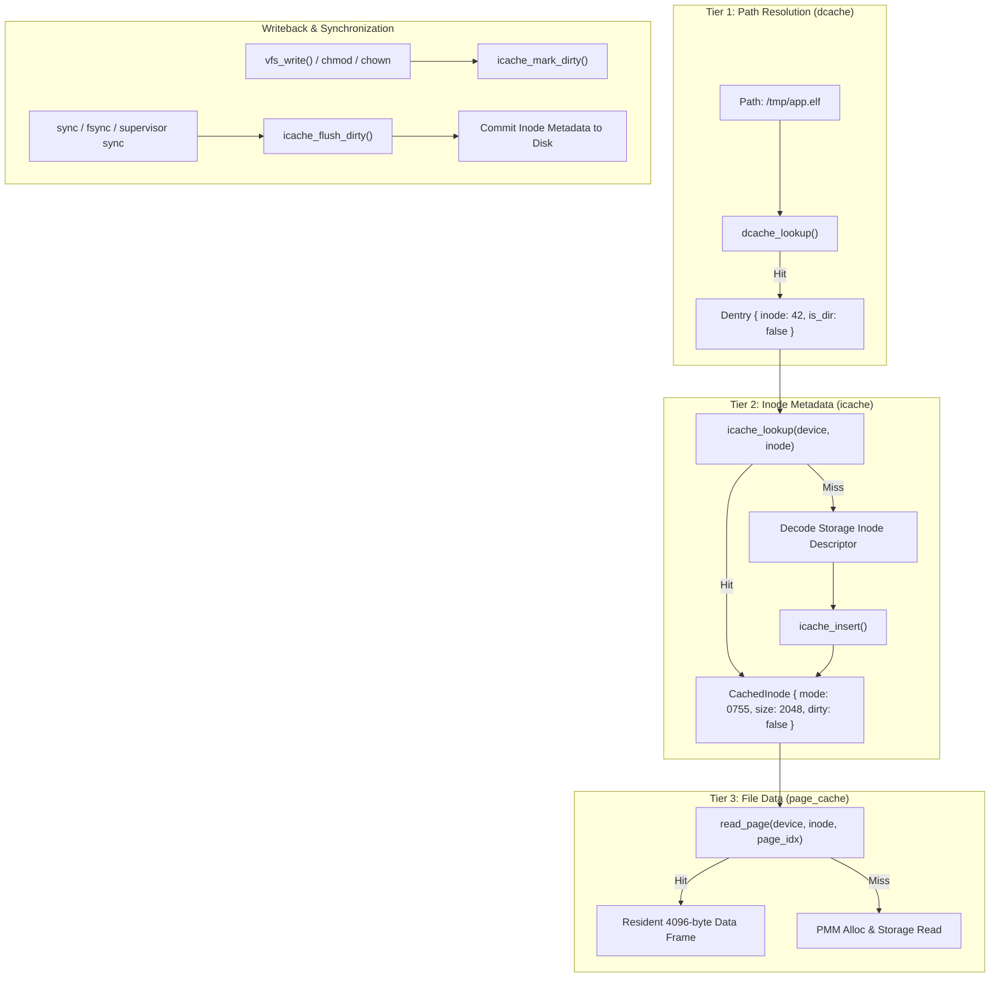

<!-- SPDX-License-Identifier: GPL-2.0-only -->

# Milestone 41: Pure Kernel VFS Inode Cache (icache) & Cache Trinity Completion

## 1. Overview & Architectural Motivation

Milestone 41 establishes the third and final foundational pillar of Virtual Filesystem (VFS) caching in Keira: the in-memory Inode Cache (`icache`). Operating entirely in Ring 0 without userland dependencies or distribution daemons, this subsystem completes the three-tier caching hierarchy modeled after the Linux kernel (`fs/inode.c`, `fs/dcache.c`, `mm/filemap.c`):

1. **The Three-Tier VFS Cache Trinity**:
   - **Tier 1 - Dentry Cache (`dcache`)**: Accelerates path string lookups (`/bin/sh.elf` -> inode index) to $O(1)$ in-memory hash searches with negative dentry elimination.
   - **Tier 2 - Inode Cache (`icache`)**: Accelerates metadata access (permissions, ownership, real file size, timestamps, link counts) to $O(1)$ memory queries, bypassing redundant storage descriptor decoding.
   - **Tier 3 - Unified Page Cache (`page_cache`)**: Caches 4096-byte file data frames in physical memory, supporting demand paging and dirty writeback.
2. **Dirty Inode Accounting & Storage Writeback**:
   - Inode metadata updates (file size growth, `chmod` permission changes, `chown` ownership transfers) mark the cached inode dirty via `INODE_FLAG_DIRTY`.
   - The kernel commits dirty inodes to non-volatile storage during system-wide `sync` (Syscall 70), `fsync` (Syscall 71) or the emergency supervisor `sync` command.
3. **Supervisor Ring 0 Observability (`icache`)**:
   - Introduces the `icache` command into the emergency supervisor debugger shell, reporting capacity, active descriptors, dirty counts, cache hit ratios, clock evictions and resident memory footprint.

---

## 2. Technical Architecture & Component Interaction

---

## 3. Implementation Details

### A. VFS Inode Cache Engine (`crates/fs/src/cache/inode.rs`)
- `CachedInode`: Fixed-size resident descriptor storing `device`, `inode`, `mode`, `uid`, `gid`, `size`, `nlink`, timestamps (`atime`, `mtime`, `ctime`), `fs_type`, `flags` and `last_access`.
- `INODE_CACHE_CAPACITY`: 64 resident inode descriptor slots.
- `icache_lookup(device, inode)`: $O(1)$ table search with atomic reference marking and monotonic tick updates.
- `icache_insert(inode)`: Inserts active inode with second-chance CLOCK replacement algorithm when the table is full.
- `icache_update_size(device, inode, new_size, mark_dirty)`: In-place file size adjustments upon storage writes.
- `icache_update_metadata(device, inode, mode, uid, gid)`: Updates permissions and ownership in-place with dirty flag propagation.
- `icache_flush_dirty()`: Traverses active dirty entries, clears dirty flags and increments writeback telemetry.

### B. Storage Synchronization Integration
- In `crates/syscall/src/dispatcher/handlers/fs.rs`: `handle_sync()` invokes `icache_flush_dirty()` before flushing disk sectors and AHCI DMA buffers.
- In `crates/shell/src/cmds/sys/control/sync.rs`: The supervisor `sync` command reports flushed dirty inode counts alongside storage sectors.

### C. Ring 0 Supervisor Command (`crates/shell/src/cmds/fs/mount/icache.rs`)
- `icache`:
  - Formats real-time inode cache metrics in standard Linux monochrome palette (`White` data and `LightGrey` labels).
  - `-c` flag clears and invalidates all resident inode slots.
  - `-f` flag flushes uncommitted dirty inodes to storage writeback.
  - `-h` flag presents built-in usage and options reference.
- Integrated into `router.rs`, `help.rs` and `engine.rs` autocomplete table.
