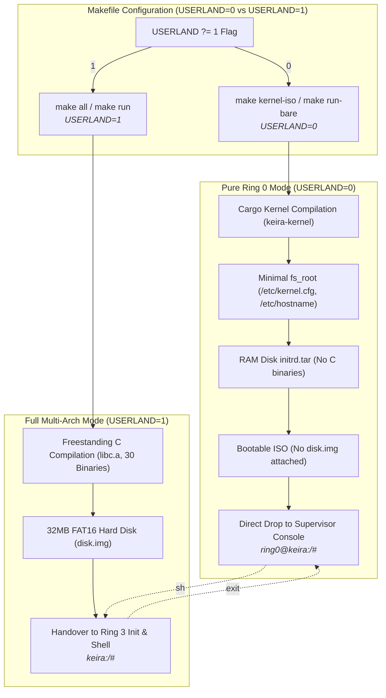

<!-- SPDX-License-Identifier: GPL-2.0-only -->

# Milestone 33: Modular Userland Decoupling & Pure Ring 0 Kernel Architecture

## Overview

Milestone 33 decouples Keira's monolithic Ring 0 kernel from the Ring 3 C userland runtime, introducing build-time and runtime modularity inspired by `torvalds/linux`. While Keira retains an in-tree freestanding C library and 30 canonical utilities in `userland/`, this milestone makes the userland build completely optional via build parameters and dedicated targets.

This architecture enables developers to build and test pure freestanding Ring 0 kernel binaries without needing a C compiler, FAT disk image formatting utilities, or user-space runtimes. When compiled in pure mode, Keira boots directly into its in-kernel Emergency Supervisor Console (`ring0@keira:/# `) without reporting warnings or missing file errors.

Milestone 33 delivers five primary architectural achievements:

1. **Build System Decoupling (`Makefile`)**:
   - Introduced `USERLAND ?= 1` configuration parameter (defaults to `1` for full backwards compatibility).
   - When `USERLAND=0`:
     - Completely skips all C userland compilation (`$(USER_ELFS)`, `$(USER_LIBC_A)` and `$(USER_CRT_OBJ)`).
     - Omits GCC and FAT disk utility requirements (`mkfs.fat`, `mmd`, `mcopy`) from preflight validation.
     - Generates a minimal RAM disk (`initrd.tar`) containing only foundational configuration files (`/etc/kernel.cfg`, `/etc/hostname`) without userland binaries.
     - Omits the 32MB FAT16 hard disk image (`disk.img`).
     - Adjusts `QEMU_FLAGS` to boot purely from the kernel ISO without attaching virtual hard disk drives.
   - Dedicated build and execution targets:
     - `make kernel`: Compiles only the Ring 0 ELF kernel binary (`$(KERNEL_BIN)`).
     - `make kernel-iso`: Compiles pure kernel and packages a bare bootable ISO (`USERLAND=0`).
     - `make run-bare`: Launches pure kernel in QEMU, directly landing in the Ring 0 Supervisor Console (`ring0@keira:/# `).
     - `make all`: Builds full OS with userland and storage devices (`USERLAND=1`).
   - Dynamic stamp invalidation (`.fs-root-stamp-$(USERLAND)`) ensuring seamless switching between pure kernel and full userland builds without manual cleaning.

2. **Kernel Runtime Adaptation (`crates/kernel`)**:
   - In `crates/kernel/src/runtime/main_loop/loop_runner.rs`:
     - Gracefully recognizes the absence of `/bin/sh` without throwing red warnings or errors on both `x86_64` and `i686`.
     - Announces pure kernel execution in green text: `[kernel] Pure freestanding Ring 0 mode: No userland /bin/sh attached.` followed by `[kernel] Entering supervisor console (Ring 0). Type 'help' for diagnostics.`
     - Drops execution directly into the Ring 0 Emergency Supervisor Console (`ring0@keira:/# `).

3. **Storage Controller & VFS Fallback (`crates/kernel` & `crates/fs`)**:
   - In `crates/kernel/src/init/storage/mount.rs`:
     - Checks active block device attachment before attempting FAT16 volume mounting.
     - If no hard disk is attached (`mounted == false`), logs clean status messages: `Probing primary storage controller (no block drive attached)` and `Mounting and initializing RAM Disk (Initrd) file system` with status 0 (no warnings or failures).
   - In `crates/fs/src/vfs/ops/node.rs` and `crates/fs/src/vfs/ops/read.rs`:
     - Implemented transparent fallback to `tar` (initrd) when `fat::VOLUME.is_none()`.
     - Enables reading system configurations (`/etc/kernel.cfg`, `/etc/hostname`) directly from initrd in pure freestanding kernel mode.

4. **Universal Verification & Dual-Architecture Parity**:
   - 100% clean builds across both 64-bit (`x86_64`) and 32-bit (`i686`) targets (`make full`).
   - 100% clean linting and formatting without warnings (`make format && make lint`).
   - 100% unit test success across all 12 workspace crates (`make test-unit`).
   - Automated end-to-end QEMU verification covering both `USERLAND=0` (pure kernel mode) and `USERLAND=1` (full userland mode).

5. **Visual Telemetry & Hardware Validation**:
   - Captured full-resolution QEMU screenshots validating bare-metal boot, supervisor console commands, userland symbolic links, native `kcc` compiler execution, network API fetch/download and supervisor drop/re-entry.

---

## Architectural Interaction

---

## Verification Artifacts

The following visual artifacts record the execution sequence in QEMU:

| Artifact | Phase | Description |
| :--- | :--- | :--- |
| `m33_01_bare_boot.png` | Phase 1 | Pure Ring 0 kernel boot screen landing directly in supervisor console without errors or warnings |
| `m33_02_bare_supervisor.png` | Phase 2 | Supervisor console executing hardware diagnostics (system, cpu, memory, disk, drivers, sync) in pure mode |
| `m33_03_full_boot.png` | Phase 3 | Full OS boot with userland disk attached, initializing into Ring 3 userland shell |
| `m33_04_full_userland.png` | Phase 4 | Full userland command verification (/bin/ln, /bin/cat, /bin/rm, /bin/ls) on FAT16 filesystem |
| `m33_05_kcc_and_net.png` | Phase 5 | Native KCC C compiler execution, ping reachability and network HTTP API fetch/download |
| `m33_06_supervisor_drop.png` | Phase 6 | Dropping from Ring 3 to Ring 0 supervisor console, inspecting SATA drive and re-entering userland via `sh` |

---

## Summary Metrics

- **Build Modularity**: Full toggle support via `USERLAND=0` (pure kernel) and `USERLAND=1` (full userland).
- **Dedicated Targets**: `make kernel`, `make kernel-iso` and `make run-bare`.
- **System Call Vectors**: 93 active POSIX syscall vectors.
- **Freestanding Core Utilities**: 30 canonical userland binaries in `/bin`.
- **Unit Tests**: 100% pass rate across all 12 crates (keira-arch, keira-core, keira-crypto, keira-fs, keira-io, keira-ipc, keira-kernel, keira-mem, keira-net, keira-shell, keira-syscall and keira-task).
- **Architecture Targets**: Parity across `x86_64` and `i686` without warnings.
