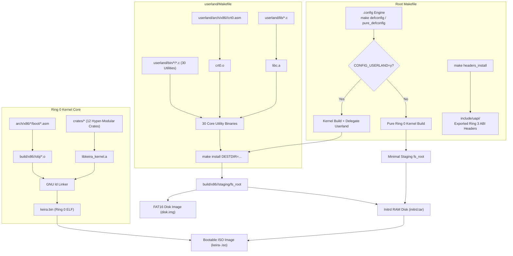

<!-- SPDX-License-Identifier: GPL-2.0-only -->

# Milestone 34: Torvalds-Grade Pure Kernel Demarcation & Autonomous Userland Architecture

## Overview

Milestone 34 finalizes Keira's architectural evolution towards version `v0.7.0`, establishing a strict privilege and build demarcation inspired directly by `torvalds/linux`. In classic Linux kernel repository style, the Ring 0 kernel tree is purified of all userland compilation logic, while the Ring 3 C userland runtime becomes a fully autonomous subsystem with its own independent build orchestrator (`userland/Makefile`).

This milestone achieves complete architectural decoupling across source code, build scripts, configuration engines and binary interfaces:

1. **Autonomous Userland Build System (`userland/Makefile`)**:
   - Manages freestanding `crt0.o`, `libc.a` and all 30 canonical userland utility binaries independently.
   - Encapsulates architecture-specific C toolchain flags (`-ffreestanding -nostdlib -m64` / `-m32`), freestanding include paths and linker scripts.
   - Provides standalone developer targets: `make -C userland all`, `make -C userland libc`, `make -C userland bins`, `make -C userland install DESTDIR=...` and `make -C userland clean`.

2. **Master `Makefile` Purification**:
   - Stripped out more than 440 lines of redundant individual C compilation rules and userland variable definitions.
   - Transformed the master `Makefile` into a pure kernel-centric orchestrator that delegates userland installation recursively via `$(MAKE) -C userland install DESTDIR=...`.
   - Preserves symmetric multi-architecture compilation for both 64-bit Long Mode (`x86_64`) and 32-bit Protected Mode (`i686`).

3. **Linux-Style Configuration Engine (`.config`)**:
   - Integrates `-include .config` with Kconfig-style variable overrides (`CONFIG_USERLAND`, `CONFIG_ARCH_*`, `CONFIG_SMP`, `CONFIG_DISK_SIZE` and `CONFIG_QEMU_MEM`).
   - Introduces canonical configuration targets:
     - `make defconfig` / `make full_defconfig`: Generates `.config` with full userland runtime enabled.
     - `make pure_defconfig` / `make kernel_defconfig`: Generates `.config` for pure freestanding Ring 0 kernel mode.
     - `make mrproper` / `make distclean`: Cleans the tree to a pristine state, removing `.config` and exported UAPI headers.

4. **UAPI Header Export Target (`make headers_install`)**:
   - Exports pristine, host-agnostic Ring 3 system call headers to `include/uapi/` (`sys/syscall.h`, `sys/stat.h`, `sys/types.h`, `sys/io_uring.h`, `sys/socket.h`, `sys/ioctl.h`, `sys/mman.h`, `errno.h`, `signal.h` and `unistd.h`).
   - Defines a formal, immutable ABI contract allowing out-of-tree runtimes and external toolchains to interface with the Keira kernel.

5. **Formal Architectural Documentation**:
   - Documented the boundary model, virtual memory layouts, System V and i386 calling conventions and error handling in `docs/architecture/uapi_boundary.md`.
   - Updated build guides and master journey documentation to reflect autonomous userland workflows.

---

## Architectural Interaction & Build Pipeline



---

## Technical Implementation Details

### Master Makefile Purification
In previous iterations, the master `Makefile` explicitly tracked 30 distinct source file lists, object lists and compilation rules for each userland utility:
```makefile
# Old monolithic pattern (repeated 30 times in root Makefile):
$(OBJ_DIR)/$(USER_DIR)/bin/cat/%.o: $(USER_DIR)/bin/cat/%.c | dirs
	$(Q)mkdir -p $(dir $@)
	$(Q)$(CC) $(USER_CFLAGS) -I$(USER_DIR)/include -c $< -o $@

$(CAT_ELF): $(USER_CRT_OBJ) $(CAT_OBJS) $(USER_LIBC_A) $(USER_LINKER_SCRIPT) | dirs
	@$(LOG_INFO) "Linking user space program: cat ($(ARCH))..."
	$(Q)$(CC) $(USER_CFLAGS) $(USER_CRT_OBJ) $(CAT_OBJS) $(USER_LIBC_A) $(USER_LDFLAGS) -o $(CAT_ELF)
```

In Milestone 34, all such rules are removed from the root `Makefile` and replaced by a single recursive delegation in `$(FS_ROOT_STAMP)`:
```makefile
# New purified delegation pattern:
$(FS_ROOT_STAMP): | dirs
	@$(LOG_INFO) "Populating canonical root filesystem via userland installation ($(ARCH))..."
	$(Q)rm -rf $(FS_ROOT) $(STAGING_DIR)/.fs-root-stamp-*
	$(Q)mkdir -p $(FS_ROOT)/bin $(FS_ROOT)/dev $(FS_ROOT)/proc $(FS_ROOT)/sys $(FS_ROOT)/etc $(FS_ROOT)/lib $(FS_ROOT)/tmp $(FS_ROOT)/var/log
	$(Q)$(MAKE) -C $(USER_DIR) install DESTDIR=$(CURDIR)/$(FS_ROOT) ARCH=$(ARCH) BUILD_DIR=$(CURDIR)/$(BUILD_DIR)/userland V=$(V)
```

### Generic Autonomous Userland Engine
`userland/Makefile` implements generic pattern evaluation with meta-rules:
```makefile
define BIN_RULE
$$(OBJ_DIR)/bin/$(1)/%.o: bin/$(1)/%.c | dirs
	$$(Q)mkdir -p $$(dir $$@)
	$$(Q)$$(CC) $$(CFLAGS) -c $$< -o $$@

$$(BIN_DIR)/$(1).elf: $(CRT_OBJ) $$(patsubst bin/$(1)/%.c,$$(OBJ_DIR)/bin/$(1)/%.o,$$(shell find bin/$(1) -type f -name "*.c")) $(LIBC_A) $(LINKER_SCRIPT) | dirs
	@$$(LOG_LD) "Linking user binary: $(1).elf ($$(ARCH))..."
	$$(Q)$$(CC) $$(CFLAGS) $(CRT_OBJ) $$(patsubst bin/$(1)/%.c,$$(OBJ_DIR)/bin/$(1)/%.o,$$(shell find bin/$(1) -type f -name "*.c")) $(LIBC_A) $$(LDFLAGS) -o $$@
	@$$(LOG_DONE) "$$(BIN_DIR)/$(1).elf ready"
endef

$(foreach b,$(BINS),$(eval $(call BIN_RULE,$(b))))
```
This architecture makes adding new utilities or userland libraries completely zero-overhead: creating a directory under `userland/bin/<name>` and adding `<name>` to `BINS` immediately compiles and installs the binary without editing the root `Makefile`.

---

## Verification & Validation Results

1. **Dual-Architecture Parity**:
   - `make full` cleanly builds both `x86_64` and `i686` targets with zero warnings and zero errors.
   - Autonomous userland standalone tests (`make -C userland all ARCH=x86_64` and `make -C userland all ARCH=i686`) compile and link all 30 binaries flawlessly.
2. **Configuration Mode Verification**:
   - `make pure_defconfig && make iso`: Generates minimal pure freestanding Ring 0 ISO from `.example.config` in ~3 seconds.
   - `make defconfig && make all`: Generates complete multi-user operating system with 30 utilities and 32MB FAT16 storage from `.example.config`.
3. **UAPI Export Verification**:
   - `make headers_install`: Seamlessly exports all Ring 3 UAPI headers to `include/uapi/` without dependencies.
4. **Code Quality & Unit Testing**:
   - `make test-unit`: All unit tests pass across all 12 hyper-modular workspace crates.
   - `make format && make lint`: Rust formatting and userland C static analysis pass with zero warnings.

---

## 5. Official Keira v0.7.0 Release Certification

With the completion of Milestone 34, Keira Kernel officially reaches the `v0.7.0` milestone. The architecture achieves:
- Strict Ring 0 / Ring 3 privilege demarcation modeled after `torvalds/linux`
- Pure freestanding Rust kernel (`no_std`) compiling across 12 hyper-modular crates
- Autonomous userland runtime with independent `userland/Makefile`, freestanding `libc.a` and 30 core utility binaries
- Zero distro bloat, canonical POSIX symbolic links (`/bin/ln`) and UAPI header export (`make headers_install`)
- Symmetrical dual-architecture (`x86_64` and `i686`) bare-metal execution with 100% test pass rate
