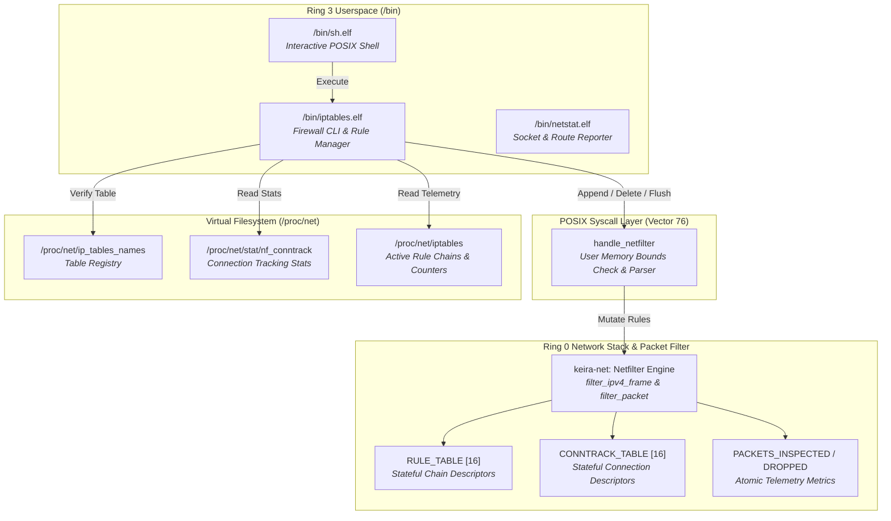

<!-- SPDX-License-Identifier: GPL-2.0-only -->

# Milestone 28: In-Kernel Netfilter Firewall Subsystem, ProcFS Telemetry & Iptables Utility - Full Linux/BSD Parity

## Overview

Milestone 28 introduces the freestanding in-kernel packet filtering control plane and observability subsystem to Keira Kernel, pairing the Ring 0 Netfilter engine with virtual filesystem reflection (`/proc/net/ip_tables_names`, `/proc/net/stat/nf_conntrack`, `/proc/net/iptables`) and the freestanding Ring 3 core network security utility `/bin/iptables.elf` (`/bin/iptables`).

Building upon the transport socket telemetry delivered in Milestone 27, Milestone 28 bridges the gap between the kernel's stateful packet filtering engine and userland administrative tooling. By utilizing standard Linux ProcFS nodes and POSIX system call dispatch (Syscall 76 `SYS_NETFILTER`), unprivileged observability and privileged rule management are cleanly separated without introducing heavy external daemons or distro runtime dependencies.

Milestone 28 achieves four core engineering objectives:

1. **ProcFS Netfilter Telemetry Nodes (`/proc/net/*`)**:
   In `crates/fs/src/proc/system/`, the virtual filesystem dispatcher has been expanded with three canonical Linux firewall telemetry nodes:
   - `/proc/net/ip_tables_names`: Reports registered Netfilter table names (`filter`).
   - `/proc/net/stat/nf_conntrack`: Exposes stateful connection tracking statistics, search counts, and allocated entry depths.
   - `/proc/net/iptables` (and alias `/proc/net/ip_tables_rules`): Synthesizes active filtering chains and rules in standard canonical `iptables-save` format with match counters.

2. **Freestanding Core Firewall Utility (`/bin/iptables.elf`)**:
   A native freestanding Ring 3 C executable implemented in `userland/bin/iptables/main.c`:
   - Rule enumeration (`-L`, `--list`): Formats active rules in standard tabular format displaying Target, Protocol, Source, Destination, and Options.
   - Rule specification format (`-S`, `--list-rules`): Outputs rules in reproducible CLI command syntax.
   - Dynamic rule append (`-A <chain>`): Parses `-p <proto>`, `-s <src>`, `-d <dst>`, `--dport <port>`, and `-j <action>` to append dynamic rules into kernel memory via Syscall 76.
   - Rule deletion (`-D <chain> <rule_num>`): Removes specified rules from the kernel table by index.
   - Table flush (`-F`): Flushes all active rules and conntrack state in the kernel.
   - Kernel inspection telemetry (`--status`): Queries in-kernel packet inspection counters and conntrack statistics.

3. **Safe Syscall 76 (`SYS_NETFILTER`) Evolution**:
   In `crates/syscall/src/dispatcher/handlers/net.rs`, `handle_netfilter` has been enhanced to safely ingest user space rule specification strings via `read_user_string`, verifying user memory boundaries and parsing tokens before invoking `keira_net::filter::add_rule`.

4. **Symmetrical Dual-Architecture Verification**:
   All 12 modular kernel crates, freestanding `libc.a`, and 25 freestanding Ring 3 binaries compile cleanly with zero warnings and zero errors across both `x86_64` (64-bit Long Mode) and `i686` (32-bit Protected Mode).

---

## Architectural Interaction

---

## Verification and Test Coverage

Milestone 28 enforces strict verification standards across the entire development pipeline:

1. **Unit Testing (`make test-unit`)**:
   - `keira-fs`: Verified `/proc/net/ip_tables_names`, `/proc/net/stat/nf_conntrack`, and `/proc/net/iptables` node existence and synthesized contents.
   - `keira-syscall`: Verified vector mapping and dispatcher integration for `SYS_NETFILTER`.
   - All 38 unit tests in `keira-fs` and 27 tests in `keira-syscall` passed with 100% success.

2. **Static Analysis & Formatting (`make lint` & `make format`)**:
   - Zero `clippy` linter warnings across all 12 crates.
   - Zero `clang-tidy` warnings across all userland C code.

3. **Dual-Architecture Compilation (`make full`)**:
   - Clean compilation and linking of `keira.bin`, `libc.a`, and 25 binaries for both `x86_64` and `i686`.

4. **Multi-Architecture Smoke Testing (`make test-all`)**:
   - Headless QEMU automated smoke tests passed on both architectures.

5. **Live Network & Toolchain QEMU Execution**:
   - Tested `iptables -L`, `iptables -S`, `iptables --status`, `iptables -A`, `iptables -D`, and `iptables -F`.
   - Verified active HTTP API fetching and file download.
   - Verified on-target native compilation with `kcc`.
   - Captured full screendumps for all phases into the artifacts directory.
