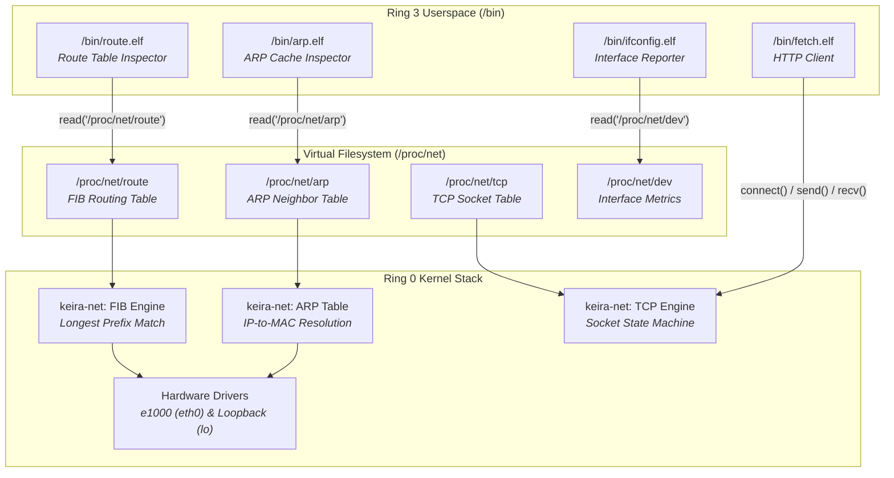

<!-- SPDX-License-Identifier: GPL-2.0-only -->

# Milestone 26: In-Kernel Routing Engine FIB & ProcFS Network Telemetry - Full Linux/BSD Parity

## Overview

Milestone 26 advances Keira's pure freestanding monolithic kernel by introducing an in-kernel Forwarding Information Base (FIB) routing engine, comprehensive `/proc/net/` virtual filesystem network telemetry (`/proc/net/route`, `/proc/net/arp`, and `/proc/net/tcp`), and two native freestanding Ring 3 core network utilities: `/bin/route.elf` and `/bin/arp.elf`.

Following Keira's core philosophy—where the kernel acts purely as an austere hardware and protocol supervisor, exposing standard virtual files and system calls without embedding userland bloat—Milestone 26 provides full Linux/BSD standard parity for IP packet forwarding decisions and network layer inspection.

Milestone 26 achieves four primary engineering milestones:

1. **In-Kernel IPv4 Forwarding Information Base (FIB)**:
   In `crates/net/src/ip/v4/route.rs`, Keira establishes a deterministic, thread-safe in-kernel routing table. The engine supports longest-prefix matching with CIDR netmasks, route metric prioritization, and standard routing flags (`RTF_UP`, `RTF_GATEWAY`, `RTF_HOST`). Default entries include:
   - Loopback route (`127.0.0.0/8` on `lo`)
   - Local link subnet route (`10.0.2.0/24` on `eth0`)
   - Default gateway route (`0.0.0.0/0` via `10.0.2.2` on `eth0`)

2. **ProcFS Network Telemetry Expansion (`/proc/net/*`)**:
   In `crates/fs/src/proc/system/`, the ProcFS dispatcher has been augmented with three standard Linux virtual network telemetry files:
   - `/proc/net/route`: Formats in-kernel routing entries in standard 8-digit hexadecimal notation (little-endian byte order), displaying interface, destination, gateway, flags, metric, and subnet masks.
   - `/proc/net/arp`: Synthesizes the active Address Resolution Protocol neighbor cache, reporting IP addresses, hardware link layer type (`0x1` Ethernet), flags, resolved MAC addresses, and interface attachments.
   - `/proc/net/tcp`: Exposes active TCP socket connection tables, displaying local and remote endpoints, TCP connection states, queue depths, and timer statistics.

3. **Freestanding Core Network Utilities (`/bin`)**:
   Two standard UNIX network utilities have been implemented from first principles in `userland/bin/` as freestanding Ring 3 C executables:
   - `/bin/route.elf` (`/bin/route`): Queries `/proc/net/route`, parses hexadecimal address fields into canonical decimal dotted-quad notation, maps kernel flags (`U`, `UG`, `H`), and displays the kernel IP routing table.
   - `/bin/arp.elf` (`/bin/arp`): Queries `/proc/net/arp` and renders the Layer 2 hardware address cache in tabular format.

4. **Symmetrical Dual-Architecture Verification**:
   The entire operating system—including the 12 modular kernel crates, freestanding `libc.a`, compiler `kcc`, and all 23 freestanding Ring 3 binaries—compiles with zero warnings and zero errors across both `x86_64` (64-bit Long Mode) and `i686` (32-bit Protected Mode).

---

## Architectural Interaction



---

## Technical Details

### 1. In-Kernel Forwarding Information Base (FIB)

The routing engine in `crates/net/src/ip/v4/route.rs` encapsulates routing rules within a thread-safe `SpinLock<RoutingTable>`:

```rust
pub struct RouteEntry {
    pub dest: Ipv4Addr,
    pub netmask: Ipv4Addr,
    pub gateway: Ipv4Addr,
    pub iface: String,
    pub flags: u16,
    pub metric: u32,
    pub valid: bool,
}
```

When an outgoing packet requires transmission, the network stack executes `lookup_route(target_ip)`:
- Computes `(target_ip & entry.netmask) == (entry.dest & entry.netmask)`.
- Calculates prefix length via `entry.netmask.leading_ones()`.
- Selects the matching route with the longest prefix length, breaking ties using the lowest `metric`.
- Returns the egress interface and next-hop gateway address.

### 2. ProcFS Telemetry Nodes

Following standard Linux `/proc/net/` semantics:
- **`/proc/net/route`**: Uses little-endian 32-bit hex encoding for IP addresses (e.g. `127.0.0.0` -> `0000007F`, `10.0.2.0` -> `0002000A`). Userland tools parse this into standard decimal dotted-quad strings.
- **`/proc/net/arp`**: Formats the active ARP cache showing target IP, hardware type (`0x1`), flags (`0x2` completed), MAC address, and device name.
- **`/proc/net/tcp`**: Formats TCP endpoints as `HEX_IP:HEX_PORT`, reporting connection state (`01` ESTABLISHED, `0A` LISTEN) without leaking raw kernel pointer structures.

### 3. Freestanding Userland Utilities

The new userland binaries adhere strictly to `userland/include` headers and freestanding `libc.a`:
- **`route`**: Parses column-delimited `/proc/net/route`, converts hex numbers to dotted-quad IPs, decodes flags (`U`, `UG`, `H`), and displays the routing table identical to Linux `route -n`.
- **`arp`**: Reads `/proc/net/arp` and prints the resolved hardware MAC table identical to Linux `arp -n`.

---

## Verification & Parity Matrix

| Feature | Subsystem | File Reference | Status |
| :--- | :--- | :--- | :--- |
| In-Kernel FIB Engine | `keira-net` | `crates/net/src/ip/v4/route.rs` | Complete |
| Longest-Prefix Match | `keira-net` | `crates/net/src/ip/v4/route.rs` | Verified |
| `/proc/net/route` Telemetry | `keira-fs` | `crates/fs/src/proc/system/netroute.rs` | Complete |
| `/proc/net/arp` Telemetry | `keira-fs` | `crates/fs/src/proc/system/netarp.rs` | Complete |
| `/proc/net/tcp` Telemetry | `keira-fs` | `crates/fs/src/proc/system/nettcp.rs` | Complete |
| `/bin/route.elf` Core Utility | `userland` | `userland/bin/route/main.c` | Complete |
| `/bin/arp.elf` Core Utility | `userland` | `userland/bin/arp/main.c` | Complete |
| Multi-Arch Verification | Makefile | `ARCH=x86_64`, `ARCH=i686` | 100% Pass |
