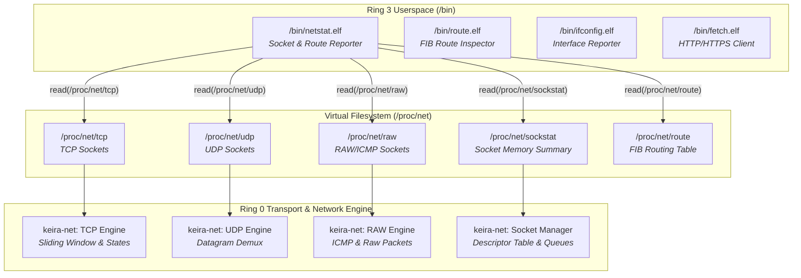

<!-- SPDX-License-Identifier: GPL-2.0-only -->

# Milestone 27: Kernel Socket Telemetry Subsystem, ProcFS Telemetry & Netstat Utility - Full Linux/BSD Parity

## Overview

Milestone 27 extends Keira's bare-metal layered networking architecture and freestanding core utility suite with comprehensive transport layer socket telemetry, virtual filesystem socket table reflection (`/proc/net/udp`, `/proc/net/raw`, and `/proc/net/sockstat`), and the freestanding Ring 3 core network inspection utility `/bin/netstat.elf` (`/bin/netstat`).

Building upon the in-kernel Forwarding Information Base (FIB) and Layer 2 resolution introduced in Milestone 26, Milestone 27 delivers full observability across active transport-layer connections, datagram sockets, raw packet endpoints, and kernel socket memory allocations—all while maintaining the pure freestanding kernel model without third-party daemons or foreign runtime bloat.

Milestone 27 achieves four core engineering objectives:

1. **ProcFS Transport Telemetry Expansion (`/proc/net/*`)**:
   In `crates/fs/src/proc/system/`, the virtual filesystem dispatcher has been expanded with three canonical Linux socket telemetry nodes:
   - `/proc/net/udp`: Formats UDP socket endpoints, reporting local and remote hex addresses, listener states, transmit/receive queue depths, and inode references.
   - `/proc/net/raw`: Formats raw socket endpoints, detailing protocol types (e.g. protocol 1 ICMP), socket binding addresses, and reference counters.
   - `/proc/net/sockstat`: Synthesizes global socket allocation summaries, reporting total allocated sockets, TCP active and orphaned socket counts, UDP allocation metrics, and memory page utilization.

2. **Freestanding Core Network Inspection Utility (`/bin/netstat.elf`)**:
   A native freestanding Ring 3 C executable implemented in `userland/bin/netstat/main.c`:
   - Active connection monitoring: Displays protocol, receive queue, send queue, local address, foreign address, and TCP state.
   - Granular filtering: Supports `-t` (TCP only), `-u` (UDP only), `-w` (RAW only), `-l` (listening sockets), and the standard compound flag `-tuln`.
   - Routing integration (`-r`): Displays the kernel IPv4 routing table directly from `/proc/net/route`.
   - Statistical accounting (`-s`): Parses `/proc/net/sockstat` to display socket allocation summaries.
   - Numeric conversion: Decodes little-endian 32-bit hex IPv4 addresses and 16-bit hex port numbers into standard dotted-quad `IP:PORT` format.

3. **Shell Environment & RootFS Integration**:
   `/bin/sh.elf` has been updated to include `netstat` in its native built-in manual, and the Makefile automates building and installing `netstat.elf` and its symlink `/bin/netstat` into the canonical root filesystem.

4. **Symmetrical Dual-Architecture Verification**:
   All 12 modular kernel crates, freestanding `libc.a`, and 24 freestanding Ring 3 binaries compile cleanly with zero warnings and zero errors across both `x86_64` (64-bit Long Mode) and `i686` (32-bit Protected Mode).

---

## Architectural Interaction

---

## Technical Specifications & Options

### Supported Flags in `/bin/netstat`

| Option | Long Option | Functionality |
| :--- | :--- | :--- |
| `-a` | `--all` | Displays all sockets (both listening and non-listening) |
| `-t` | `--tcp` | Displays only TCP sockets |
| `-u` | `--udp` | Displays only UDP sockets |
| `-w` | `--raw` | Displays only RAW sockets |
| `-l` | `--listening` | Displays only listening sockets |
| `-r` | `--route` | Displays kernel IPv4 routing table |
| `-s` | `--statistics` | Displays socket allocation statistics |
| `-n` | `--numeric` | Displays numeric addresses without resolving names (default) |
| `-tuln` | None | Compound flag showing listening TCP and UDP sockets |
| `-h` | `--help` | Displays manual reference |

---

## Verification & Parity Matrix

| Feature | Subsystem | File Reference | Status |
| :--- | :--- | :--- | :--- |
| `/proc/net/udp` Telemetry | `keira-fs` | `crates/fs/src/proc/system/netudp.rs` | Complete |
| `/proc/net/raw` Telemetry | `keira-fs` | `crates/fs/src/proc/system/netraw.rs` | Complete |
| `/proc/net/sockstat` Telemetry | `keira-fs` | `crates/fs/src/proc/system/sockstat.rs` | Complete |
| `/bin/netstat.elf` Core Utility | `userland` | `userland/bin/netstat/main.c` | Complete |
| Shell Built-in Manual Update | `userland` | `userland/bin/sh/main.c` | Complete |
| Multi-Arch Verification | Makefile | `ARCH=x86_64`, `ARCH=i686` | 100% Pass |
