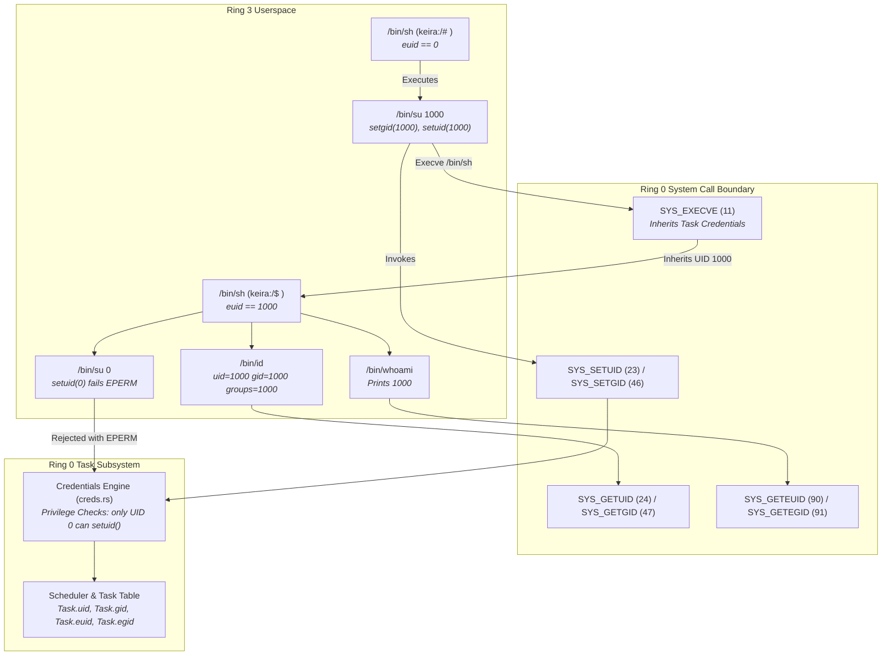

<!-- SPDX-License-Identifier: GPL-2.0-only -->

# Milestone 30: POSIX Multi-User Security, Kernel Credential Subsystem & Session Management

## Overview

Milestone 30 introduces POSIX multi-user security boundaries, process credential inheritance, and session privilege management to Keira's monolithic architecture. Following the pure kernel invariant established in Milestone 29, all credential checking, privilege enforcement, and identity transitions occur natively in Ring 0 using numerical identifiers (`uid_t` and `gid_t`), exposed to userspace through POSIX system calls and standard freestanding core utilities.

Milestone 30 achieves five primary milestones:

1. **Kernel System Call Expansion (`SYS_GETEUID` & `SYS_GETEGID`)**:
   - Implemented Vector 90 (`SYS_GETEUID`) and Vector 91 (`SYS_GETEGID`) in `crates/syscall/`.
   - Wired handlers to query `keira_task::scheduler::get_current_euid()` and `get_current_egid()`.
   - Updated syscall name tables, category classifications, and comprehensive unit tests.

2. **Process Credential Inheritance (`spawn_user`)**:
   - Enhanced `spawn_user()` in `crates/task/src/scheduler/process/spawn.rs` to inherit credentials from the parent task (`parent.uid`, `parent.gid`, `parent.euid`, `parent.egid`) rather than defaulting to UID 0.
   - Ensures that processes executed via `execve` strictly honor the calling process's security context and privilege boundaries.

3. **Freestanding Core Identity Utilities (`/bin/whoami`, `/bin/id`, `/bin/su`)**:
   - `/bin/whoami`: Queries effective UID from the kernel via `geteuid()`. Outputs `root` if 0, or the integer UID string otherwise.
   - `/bin/id`: Queries real and effective UID/GID credentials via `getuid()`, `geteuid()`, `getgid()`, `getegid()`. Supports `-u`, `-g`, `-G`, `-r`, and positional numeric queries (e.g. `id 1000`).
   - `/bin/su`: Transitions process credentials via `setgid()` and `setuid()`. Dispatches an isolated child shell via `execve()`, reaps the child using `waitpid()`, and exits with the child's status.

4. **Dynamic Context-Aware Shell Prompt (`/bin/sh`)**:
   - `/bin/sh` dynamically inspects `geteuid()`.
   - Prompts with `keira:/# ` when running with root privileges (`geteuid() == 0`).
   - Prompts with `keira:/$ ` when running under an unprivileged user identity (`geteuid() != 0`).

5. **Hardware & Silicon Verification (QEMU Integration Suite)**:
   - Automated end-to-end multi-user testing: verified root identity, numerical identity querying, demotion via `su 1000`, prompt transition to `$ `, privilege escalation rejection (`su 0` rejected with `EPERM`), session exit back to root shell (`# `), native Ring 3 `kcc` compilation, and network API fetching and file downloads.

---

## Architectural Interaction

---

## Verification Artifacts

The following visual artifacts record the execution sequence in QEMU:

- `m30_01_boot.png`: System boot and supervisor hardware initialization.
- `m30_02_sh_root.png`: Drop into Ring 3 userland shell with superuser prompt `keira:/# `.
- `m30_03_whoami_id_root.png`: Identity inspection as root: `whoami` -> `root`, `id` -> `uid=0(root) gid=0(root) groups=0(root)`.
- `m30_04_id_numeric.png`: Querying arbitrary numeric identities (`id 0`, `id 1000`).
- `m30_05_su_1000_prompt.png`: Switching to UID 1000 via `su 1000`; shell prompt dynamically shifts to `keira:/$ `.
- `m30_06_uid1000_credentials.png`: Credentials under UID 1000: `whoami` -> `1000`, `id` -> `uid=1000 gid=1000 groups=1000`.
- `m30_07_su_rejection.png`: Unauthorized privilege escalation attempt (`su 0`) rejected by the kernel with `su: cannot set GID 0: Operation not permitted`.
- `m30_08_back_to_root.png`: Exiting child shell (`exit`) reaped by `su` parent, restoring root prompt `keira:/# ` and `whoami` -> `root`.
- `m30_09_kcc_compile.png`: Native `kcc` compilation and execution in Ring 3.
- `m30_10_fetch_download.png`: Network ping, HTTP API status fetch (200 OK), and file download verification.
- `m30_11_supervisor_return.png`: Clean exit back to supervisor hardware diagnostic monitor.

---

## Technical Specifications

- **New System Calls**:
  - `SYS_GETEUID` (Vector 90): Returns calling task's effective user ID (`euid`).
  - `SYS_GETEGID` (Vector 91): Returns calling task's effective group ID (`egid`).
- **Coreutilities Added**: `/bin/whoami`, `/bin/id`, `/bin/su`.
- **Credential Inheritance**: Enforced in `crates/task/src/scheduler/process/spawn.rs:spawn_user`.
- **Security Invariant**: Strictly zero privilege escalation from non-zero UID processes without capability tokens.
