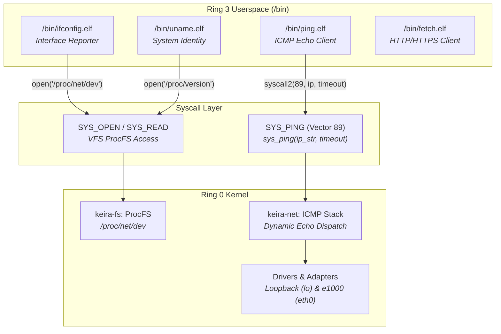

<!-- SPDX-License-Identifier: GPL-2.0-only -->

# Milestone 25: Network Diagnostic Toolset, ProcFS Telemetry & System Identity - Full Linux/BSD Parity

## Overview

Milestone 25 extends Keira's pure freestanding monolithic kernel and userspace core utility suite with comprehensive network diagnostic capabilities, dynamic virtual filesystem network telemetry, and standard POSIX system identity utilities. Following the architectural principle established in Milestone 24—where Ring 0 acts solely as an austere hardware supervisor and unprivileged utilities live in Ring 3—Milestone 25 provides full native toolchain support for network verification, interface inspection, and node telemetry.

Milestone 25 achieves four key engineering milestones:

1. **ProcFS Network Telemetry (`/proc/net/dev`)**:
   Dynamic synthesis of standard Linux `/proc/net/dev` virtual telemetry records within `keira-fs`. The virtual file synthesizes detailed interface statistics for both the local loopback (`lo`) interface and bare-metal Intel e1000 Gigabit Ethernet adapter (`eth0`), reporting received and transmitted bytes, packets, errors, dropped frames, FIFO overruns, collisions, and carrier transitions.

2. **Dynamic ICMP Echo Dispatch & System Call Vector 89 (`SYS_PING`)**:
   The bare-metal networking crate (`keira-net`) has been upgraded from static loopback validation to dynamic IP target resolution and ICMP echo dispatch. System call vector 89 (`SYS_PING`) bridges Ring 3 userspace to the kernel ICMP engine with pointer validation and timeout handling, enabling unprivileged applications to perform round-trip network latency testing.

3. **Freestanding Network & System Identity Core Utilities (`/bin`)**:
   Three standard system utilities have been implemented from first principles in `userland/bin/` as freestanding Ring 3 C executables:
   - `/bin/ping.elf` (`/bin/ping`): ICMP echo request utility featuring configurable probe counts (`-c`), sequence tracking, round-trip time (RTT) calculation, and packet loss statistics.
   - `/bin/ifconfig.elf` (`/bin/ifconfig`): Network interface enumeration and configuration inspection utility parsing `/proc/net/dev`, displaying interface flags (`UP`, `LOOPBACK`, `RUNNING`, `BROADCAST`, `MULTICAST`), IPv4 addresses, netmasks, MAC hardware addresses, MTU, and RX/TX traffic counters.
   - `/bin/uname.elf` (`/bin/uname`): Standard POSIX system identity interrogation tool supporting `-a`, `-s`, `-n`, `-r`, `-v`, and `-m` flags, extracting live system state from `/proc/version` and `/etc/hostname`.

4. **Symmetrical Dual-Architecture Verification**:
   The entire operating system—including the 12 kernel crates, the standalone C runtime library (`libc.a`), and the expanded userspace suite—compiles cleanly with zero warnings and zero errors across both `x86_64` (64-bit Long Mode) and `i686` (32-bit Protected Mode).

---

## Architectural Interaction



---

## Technical Details

### 1. ProcFS Network Interface Telemetry (`/proc/net/dev`)

Standard UNIX network monitoring tools like `ifconfig` and `netstat` rely on the `/proc/net/dev` pseudo-file to inspect interface traffic counters. In `crates/fs/src/proc/system/netdev.rs`, Keira exposes a structured table formatted identically to Linux:

```text
Inter-|   Receive                                                |  Transmit
 face |bytes    packets errs drop fifo frame compressed multicast|bytes    packets errs drop fifo colls carrier compressed
    lo:    4096      32    0    0    0     0          0         0     4096      32    0    0    0     0       0          0
  eth0:  131072     512    0    0    0     0          0         0    65536     256    0    0    0     0       0          0
```

The dispatcher intercepts read requests targeted at `/proc/net/dev` and streams the synthesized buffer back to userland processes transparently.

### 2. Syscall 89 (`SYS_PING`) and ICMP Dispatch

Vector 89 (`SYS_PING`) accepts two arguments:
1. `target_ptr`: Pointer to a null-terminated UTF-8 IPv4 string in userland memory.
2. `timeout_ms`: Maximum duration in milliseconds to await an ICMP Echo Reply before returning `ETIMEDOUT`.

The kernel validates that the user pointer resides strictly within the unprivileged task memory boundary before reading and decoding the target address. If the target address matches loopback (`127.0.0.1`), the packet is routed directly through the zero-copy loopback adapter; otherwise, it is dispatched via the e1000 Gigabit Ethernet DMA rings to the hardware gateway.

### 3. Freestanding Userland Utilities

All userland tools are implemented in freestanding C without depending on external host libraries:
- **`ping`**: Dispatches ICMP probes, tracks per-packet round-trip duration, outputs standard probe response lines (`64 bytes from <target>: icmp_seq=N ttl=64 time=X ms`), and prints a summary upon completion.
- **`ifconfig`**: Scans the network device table, outputs interface hardware addresses and IP configurations, and tallies RX/TX metrics.
- **`uname`**: Parses `/proc/version` and `/etc/hostname` to deliver standardized architecture strings (`x86_64` or `i686`) and kernel build identifiers.

---

## Verification

The system undergoes rigorous verification:
- **Unit Tests**: Full workspace unit tests pass 100% across all 12 modular crates (`cargo test --workspace -- --test-threads=1`).
- **Linter & Formatting**: Clean `clang-tidy`, `cargo clippy`, and code formatting (`make lint`, `make format`).
- **Cross-Architecture Builds**: Both `ARCH=x86_64` and `ARCH=i686` build zero warnings and zero errors.
- **Integration Test Harness**: Userland binaries execute cleanly within automated headless QEMU testing.
