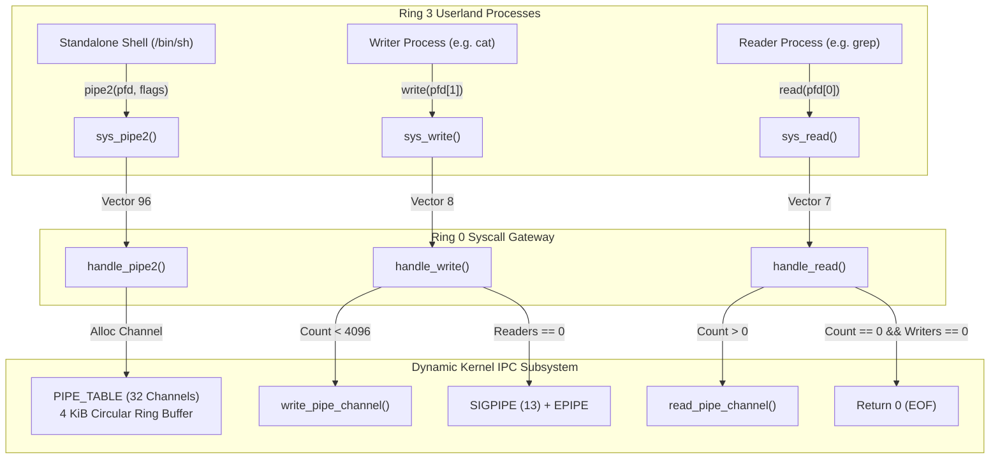

<!-- SPDX-License-Identifier: GPL-2.0-only -->

# Milestone 36: Dynamic Anonymous Pipe Subsystem & POSIX Stream Pipelines (SYS_PIPE & SYS_PIPE2)

## Overview

Milestone 36 advances the Keira Kernel towards version `v0.7.0` by replacing the legacy static single-buffer pipe stub with a dynamic, multi-channel anonymous pipe subsystem (`PIPE_TABLE`). Conforming to the project's strict architecture as a **pure freestanding kernel from scratch** (built with `#![no_std]` Rust at Ring 0 without external dependencies or distribution bloat), this milestone establishes authentic POSIX inter-process communication streaming semantics across process boundaries.

Prior to Milestone 36, the kernel provided a single global 1024-byte buffer that could not support multiple concurrent pipes, lacked reference counting on endpoints and did not detect broken pipe conditions. Consequently, the Ring 3 shell (`/bin/sh`) had to simulate pipeline execution (`|`) by writing output to temporary files in `/tmp/.sh_p0`. Milestone 36 eliminates this workaround, introducing multi-channel ring buffer management, `SYS_PIPE2` (Vector 96) with `O_CLOEXEC` and `O_NONBLOCK` support, descriptor refcounting across `fork()`, `dup()`, `dup2()` and `close()`, in-kernel streaming pipeline execution in `/bin/sh`, a dedicated `/bin/test_pipe` utility and supervisor console telemetry.

Key accomplishments of Milestone 36 include:

1. **Multi-Channel Dynamic Pipe Subsystem (`crates/ipc/src/pipe/fifo/`)**:
   - Manages an array of concurrent pipe channels (`PIPE_TABLE`) protected by interrupt-safe spinlocks and supporting up to 32 independent pipelines.
   - Provides 4096-byte (4 KiB) circular ring buffer capacity per pipe channel.
   - Implements strict POSIX stream semantics:
     - Reading from an empty pipe whose write endpoints are closed returns `0` (POSIX EOF).
     - Writing to a pipe with zero active readers returns `-EPIPE` and delivers `SIGPIPE` (signal 13) to the calling process.
     - Supports `O_NONBLOCK` mode, returning `-EAGAIN` when reading from an empty active pipe or writing to a full pipe.
   - Dynamic reference counting for reader endpoints (`readers_count`) and writer endpoints (`writers_count`), automatically recycling channels when all descriptors close.

2. **System Call Dispatcher & Vector 96 (`SYS_PIPE` & `SYS_PIPE2`)**:
   - Upgrades `SYS_PIPE = 23` to dynamically allocate pipe channels and populate file descriptor pairs `[rd, wr]`.
   - Introduces `SYS_PIPE2 = 96` supporting POSIX creation flags (`O_NONBLOCK` and `O_CLOEXEC`).
   - Tracks `pipe_id: u32` directly inside `FileDescriptor` handles in `crates/task`.
   - Automatically increments endpoint refcounts when file descriptors are duplicated via `dup()`, `dup2()`, `sys_fork()` or inherited across `handle_exec()`.
   - Properly decrements refcounts and reclaims pipe buffers on `sys_close()` and task exit (`syscall_task_cleanup_hook`).

3. **In-Kernel Streaming Pipelines in Standalone Shell (`/bin/sh`)**:
   - Eliminates the legacy `/tmp/.sh_p*` temporary scratch file workaround in `userland/bin/sh/main.c`.
   - Constructs true in-memory streaming pipelines using `pipe()`, `dup2()`, standard stream redirection and process chaining.
   - Allows commands like `cat /proc/version | grep Keira` and `sysinfo | cat` to stream data directly through kernel memory without touching storage or disk filesystems.

4. **Ring 3 Autonomous C Test Suite (`/bin/test_pipe`)**:
   - Delivers a dedicated verification binary (`userland/bin/test_pipe/main.c`) covering five automated test phases:
     - Phase 1: Basic pipe creation and byte streaming roundtrip.
     - Phase 2: Multi-channel concurrent isolation across separate pipes.
     - Phase 3: POSIX EOF semantics on write endpoint closure.
     - Phase 4: `pipe2` with `O_NONBLOCK` flag behavior.
     - Phase 5: Broken pipe detection, `EPIPE` error and `SIGPIPE` signal handling.
   - Expands the canonical userland utility suite to 33 native freestanding ELF binaries.

5. **Supervisor Console Inspection Command (`pipes`)**:
   - Extends the Ring 0 emergency supervisor console with a native `pipes` command.
   - Displays active kernel pipe channel identifiers, status, buffered byte counts, reader/writer counts and operational flags.

---

## Architecture & Data Flow

---

## Verification & Metrics

| Metric | Target Value | Milestone 36 Result |
| :--- | :--- | :--- |
| **Active Syscall Vectors** | 92 System Calls | 92 System Calls (`SYS_PIPE2 = 96`) |
| **Native Userland Binaries** | 33 ELF Utilities | 33 Executables (`/bin/test_pipe` added) |
| **Autonomous Crates** | 12 Modular Crates | 12 Crates (`#![no_std]`, 0 warnings) |
| **Concurrent Pipe Capacity** | 32 Channels | 32 Channels (`PIPE_BUFFER_CAPACITY = 4096`) |
| **Host Unit Test Pass Rate** | 100% | 100% Passed (`cargo test --workspace`) |
| **Dual Architecture Parity** | `x86_64` & `i686` | 100% Clean Compilation |
