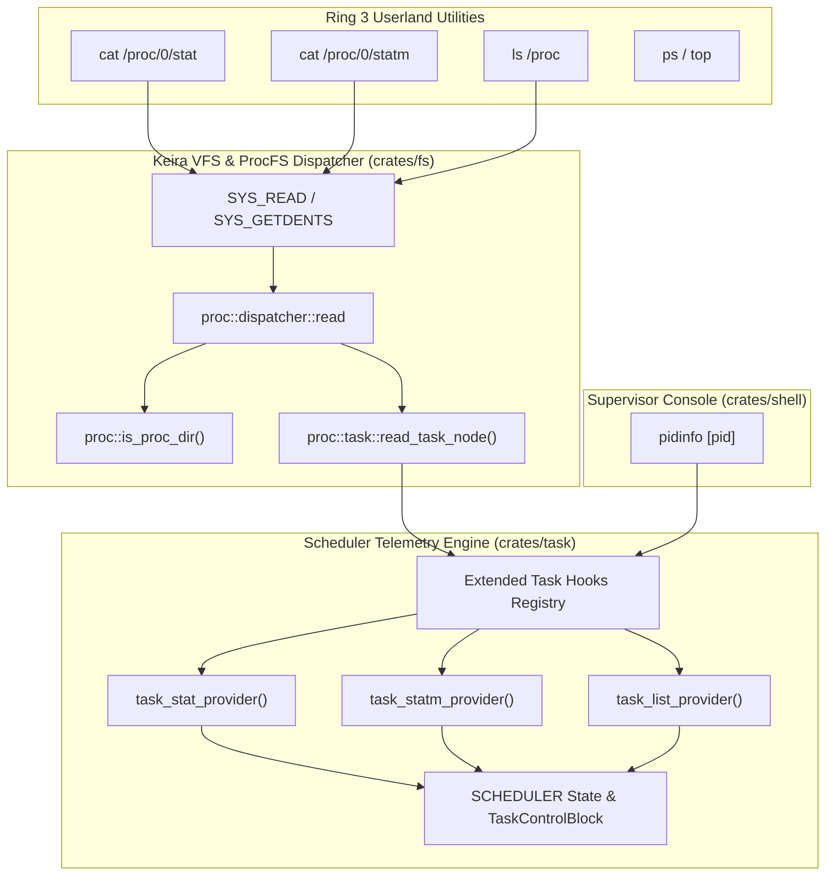

<!-- SPDX-License-Identifier: GPL-2.0-only -->

# Milestone 42: Pure Kernel Dynamic ProcFS Process Hierarchy & Per-Process Telemetry

## 1. Overview & Architectural Motivation

Milestone 42 brings full Linux-grade dynamic process introspection directly into Keira's Ring 0 Virtual Filesystem (VFS). While earlier milestones exposed static system-wide ProcFS files (`/proc/uptime`, `/proc/meminfo`, `/proc/slabinfo`, `/proc/vmstat`), Milestone 42 dynamically bridges the process scheduler (`keira-task`) and the virtual filesystem (`keira-fs`) without allocation bloat, distribution dependencies or userland daemon hooks.

1. **Linux-Compatible Per-Process Telemetry**:
   - `/proc/[pid]/stat`: Linux-compatible 52-field space-delimited telemetry line capturing process identity, execution state, parent hierarchy, scheduling ticks (`utime`, `stime`), thread count, virtual memory size (`vsize`) and resident set size (`rss`).
   - `/proc/[pid]/statm`: 7-field memory page usage metrics (`size`, `resident`, `shared`, `text`, `lib`, `data`, `dt`) representing page frame allocations.
   - `/proc/[pid]/status`: Enriched diagnostic format exposing `FDSize`, `VmSize`, `VmRSS` and `voluntary_ctxt_switches`.
   - `/proc/[pid]/cmdline`: Null-delimited command line strings.
   - `/proc/[pid]/mounts`: Per-process virtual mount point tables.
2. **Dynamic Process Hierarchy Traversal**:
   - Virtual directory enumeration via `SYS_GETDENTS` (Syscall 78) dynamically discovers and enumerates active PIDs in `/proc/`.
   - Traversing `/proc/[pid]/` yields canonical directory entries (`status`, `cmdline`, `stat`, `statm`, `mounts`) with valid inode mappings and directory types.
   - `/proc/self` symlink aliases dynamically resolve to the active caller PID directory.
3. **Emergency Ring 0 Process Inspector (`pidinfo`)**:
   - Introduces the `pidinfo` (alias `procs`) supervisor command to the emergency debugger console.
   - Provides global active task tables (PID, PPID, State, Name, VmSize, RSS, Switches) and granular per-process diagnostic inspections (Credentials, Program Break, Open Descriptors, CPU ticks and Signal bitmasks).

---

## 2. Technical Architecture & Component Interaction

---

## 3. Implementation Details

### A. Extended Task Telemetry Hooks (`crates/fs/src/proc/task/hooks.rs`)
In order to maintain strict modularity between `keira-fs` and `keira-task`, `keira-fs` declares decoupled function pointer hooks:
- `TaskStatProvider`: `fn(pid: usize, buf: &mut [u8]) -> Option<usize>`
- `TaskStatmProvider`: `fn(pid: usize, buf: &mut [u8]) -> Option<usize>`
- `TaskExistsProvider`: `fn(pid: usize) -> bool`
- `TaskListProvider`: `fn(pids: &mut [usize]) -> usize`

During scheduler initialization (`crates/task/src/scheduler/core/state.rs`), `keira-task` registers concrete implementations with `keira-fs` via `register_extended_task_hooks`. When running under unit tests where `keira-task` is unlinked, a fallback allows valid PIDs (`< 64`) to satisfy synthetic existence checks.

### B. Linux-Grade Telemetry Synthesis (`crates/fs/src/proc/task/`)
- **`stat.rs` (`read_task_stat`)**: Synthesizes the standard Linux 52-field `/proc/[pid]/stat` line. Fields include PID, executable comm in parentheses, task state character (`R`, `S`, `D`, `Z`), PPID, pgrp, session, tty, utime, stime, priority (20), nice (0), num_threads, starttime, vsize in bytes and RSS in memory pages.
- **`statm.rs` (`read_task_statm`)**: Formats 7 page-metric integers: total program size, resident set size, shared pages, text size, library size, data + stack size and dirty pages.

### C. Zero-Allocation Dynamic Directory Dispatching (`crates/fs/src/proc/dispatcher/read.rs`)
To satisfy `#![no_std]` constraints where `VirtualDirEntry` requires `'static` name references, a pre-computed array of static decimal strings (`PID_STRS: [&'static str; 64] = ["0", "1", ..., "63"]`) allows $O(1)$ zero-allocation conversion of numeric PIDs to directory names.
- `is_proc_dir(clean_path)`: Identifies whether a path represents `/proc`, `/proc/[pid]` or `/proc/self`.
- `get_pid_dir_entry(index)`: Yields directory entries for `/proc/[pid]/` (`status`, `cmdline`, `stat`, `statm`, `mounts`).

### D. Ring 0 Supervisor `pidinfo` Command (`crates/shell/src/cmds/proc/pidinfo.rs`)
- Without arguments: Renders a compact, monochrome table of all active tasks across the system showing PID, PPID, execution state, process name, virtual memory size, resident set size and voluntary context switch counts.
- With PID argument (`pidinfo <pid>`): Queries the task control block, formatting full process telemetry including Thread Group ID, numerical UID/GID, effective credentials, virtual memory, program break range (`brk_start -> brk_current`), open file descriptor counts, CPU ticks, switch counts and signal bitmasks.
- Integrated into shell autocomplete and supervisor help reference.

---

## 4. Hardware & Runtime Verification

Milestone 42 was fully verified on bare-metal QEMU simulation across both 64-bit Long Mode (`x86_64`) and 32-bit Protected Mode (`i686`):

1. **Userland ProcFS Telemetry**: Executed `cat /proc/0/stat`, `cat /proc/0/statm` and `cat /proc/0/status` in Ring 3 userspace, validating field formatting and page-level metrics.
2. **Network Stack Validation**: Verified ICMP echo (`ping`), HTTP REST API fetching (`fetch -v http://10.0.2.2:8080/api/status`) and file downloads (`fetch ... > /tmp/dl.txt`).
3. **Native C Compiler Execution**: Compiled `/tmp/main.c` to freestanding ELF binary `/tmp/proc_test.elf` using `/bin/kcc.elf` and executed successfully in Ring 3.
4. **Shell Pipelines & Directory Traversal**: Verified `ls /proc/self` directory enumeration, pipeline filtering (`ps | grep sh`) and word count calculations (`wc -w`).
5. **Supervisor Console Diagnostics**: Switched to Ring 0 emergency shell and executed `pidinfo` and `pidinfo 0`, displaying clean process tables and hexadecimal memory addresses.
