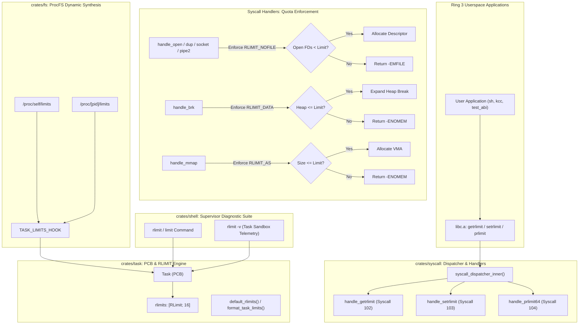

<!-- SPDX-License-Identifier: GPL-2.0-only -->

# Milestone 46: Process Resource Limits (RLIMIT), Memory/FD Quota Enforcement & Process Sandboxing

## 1. Overview & Architectural Motivation

Milestone 46 establishes an in-kernel process resource limiting and sandboxing subsystem for the Keira Kernel. Operating in conjunction with Hardware W^X Mitigations (Milestone 43), Kernel ASLR (Milestone 44) and Dynamic Stack Canary Protection (Milestone 45), resource limits (`rlimit`) restrict consumption of CPU time, memory allocations, open file descriptors and concurrent processes to protect the operating system against resource exhaustion, denial-of-service (DoS) attacks and runaway processes.

Prior to Milestone 46, userland tasks shared global kernel resource capacities without per-process quota enforcement, allowing any process to exhaust file descriptor slots or consume address space. Milestone 46 resolves this isolation gap through a pure monolithic kernel accounting subsystem:

1. **In-Kernel PCB Resource Accounting (`crates/task/src/rlimit/`)**:
   - Each process descriptor (`Task`) embeds an array of 16 resource limits: `rlimits: [RLimit; RLIM_NLIMITS]`.
   - Defines standard limits: `RLIMIT_CPU` (0), `RLIMIT_FSIZE` (1), `RLIMIT_DATA` (2), `RLIMIT_STACK` (3), `RLIMIT_CORE` (4), `RLIMIT_RSS` (5), `RLIMIT_NPROC` (6), `RLIMIT_NOFILE` (7), `RLIMIT_MEMLOCK` (8), `RLIMIT_AS` (9), `RLIMIT_LOCKS` (10), `RLIMIT_SIGPENDING` (11), `RLIMIT_MSGQUEUE` (12), `RLIMIT_NICE` (13), `RLIMIT_RTPRIO` (14) and `RLIMIT_RTTIME` (15).
   - Tracks both soft limits (`rlim_cur`) and hard limits (`rlim_max`).
   - Limits are inherited across `fork()`, `clone()` and `spawn_user()`.
2. **Standard POSIX Resource System Calls (`crates/syscall`)**:
   - Implements native syscall vector 102: `SYS_GETRLIMIT` (query calling task resource limits).
   - Implements native syscall vector 103: `SYS_SETRLIMIT` (set calling task resource limits with unprivileged restriction).
   - Implements native syscall vector 104: `SYS_PRLIMIT64` (query and modify limits of an arbitrary process with credential validation).
3. **Hard Quota Enforcement in Kernel Syscall Handlers**:
   - **File Descriptors (`RLIMIT_NOFILE`)**: Enforced in `handle_open`, `fcntl(F_DUPFD)`, `handle_dup`, `handle_pipe2` and `handle_socket`. Scans slots up to `min(RLIMIT_NOFILE.cur, MAX_FDS)` and returns `-EMFILE` when quota is exceeded.
   - **Heap Break (`RLIMIT_DATA`)**: Enforced in `handle_brk`. Validates `new_brk - program_break_start <= RLIMIT_DATA.cur`, returning `-ENOMEM` when limit is violated.
   - **Virtual Address Space (`RLIMIT_AS`)**: Enforced in `handle_mmap`. Validates mapping size against `RLIMIT_AS.cur`, returning `-ENOMEM` on violation.
4. **Virtual ProcFS Telemetry (`crates/fs/src/proc/task/limits.rs`)**:
   - Synthesizes `/proc/[pid]/limits` and `/proc/self/limits` formatted identically to Linux standard output.
   - Outputs table header (`Limit`, `Soft Limit`, `Hard Limit`, `Units`) and formats unlimited values as `unlimited`.
5. **Supervisor Command Suite Integration (`crates/shell`)**:
   - Adds `rlimit` (alias `limit`) to the Ring 0 diagnostic console.
   - Displays all 16 process resource limits with soft/hard values and units.
   - Supports `-v` (verbose) flag displaying active task sandboxing telemetry (PID, Name, Open FDs, FD Limit, Heap usage and Data Limit).

---

## 2. Technical Architecture & Component Interaction

---

## 3. System Call Vector Definitions & ABI Parity

Milestone 46 expands Keira's native system call table with vectors 102 through 104:

| Syscall Number | Linux Alias | Symbol Name | Signature | Description |
|---|---|---|---|---|
| **102** | 97 | `sys_getrlimit` | `int getrlimit(int resource, struct rlimit *rlim)` | Query soft and hard resource limits of calling process |
| **103** | 160 | `sys_setrlimit` | `int setrlimit(int resource, const struct rlimit *rlim)` | Set soft and hard resource limits of calling process |
| **104** | 302 | `sys_prlimit64` | `int prlimit(pid_t pid, int resource, const struct rlimit *new, struct rlimit *old)` | Query and set 64-bit resource limits of target process |

---

## 4. In-Kernel Quota Enforcement Architecture

The 16 standard POSIX resource limits are managed in pure freestanding Rust without external dependencies:

| Constant | Resource Name | Soft Default | Hard Default | Unit | Enforcing Subsystem |
|---|---|---|---|---|---|
| `RLIMIT_CPU` (0) | Max cpu time | `unlimited` | `unlimited` | seconds | Scheduler Accounting |
| `RLIMIT_FSIZE` (1) | Max file size | `unlimited` | `unlimited` | bytes | VFS Write Operations |
| `RLIMIT_DATA` (2) | Max data size | 32 MiB | 64 MiB | bytes | Heap Manager (`handle_brk`) |
| `RLIMIT_STACK` (3) | Max stack size | 8 MiB | 16 MiB | bytes | Stack Allocation Subsystem |
| `RLIMIT_CORE` (4) | Max core file size | 0 | `unlimited` | bytes | Core Dump Engine |
| `RLIMIT_RSS` (5) | Max resident set | `unlimited` | `unlimited` | bytes | VMM Paging Engine |
| `RLIMIT_NPROC` (6) | Max processes | 64 | 64 | processes | Task Spawner (`spawn_user`) |
| `RLIMIT_NOFILE` (7) | Max open files | 32 | 32 | files | Descriptor Table (`open`, `pipe2`, `socket`) |
| `RLIMIT_MEMLOCK` (8) | Max locked memory | 64 KiB | 64 KiB | bytes | Memory Locking Subsystem |
| `RLIMIT_AS` (9) | Max address space | 128 MiB | 256 MiB | bytes | VMM Mmap Subsystem (`handle_mmap`) |
| `RLIMIT_LOCKS` (10) | Max file locks | `unlimited` | `unlimited` | locks | Advisory Lock Manager |
| `RLIMIT_SIGPENDING` (11) | Max pending signals | 64 | 64 | signals | Signal Queue Subsystem |
| `RLIMIT_MSGQUEUE` (12) | Max msgqueue size | 800 KiB | 800 KiB | bytes | POSIX Message Queue Subsystem |
| `RLIMIT_NICE` (13) | Max nice priority | 0 | 0 | priority | Scheduler Priority Engine |
| `RLIMIT_RTPRIO` (14) | Max realtime priority | 0 | 0 | priority | Scheduler Realtime Engine |
| `RLIMIT_RTTIME` (15) | Max realtime timeout | `unlimited` | `unlimited` | us | Watchdog Subsystem |

---

## 5. Verification & Quality Assurance

All Milestone 46 features have undergone dual-architecture verification and live QEMU execution:

1. **Userland ABI Test 35 (`test_abi`)**:
   - Reads default `RLIMIT_NOFILE` via `getrlimit` and verifies valid values.
   - Verifies invalid resource indices return `EINVAL`.
   - Verifies NULL pointers return `EFAULT`.
   - Lowers `RLIMIT_NOFILE` in child process and verifies subsequent `open()` calls fail with `EMFILE`.
   - Reads `/proc/self/limits` and validates table headers and content formatting.
2. **Quality Gate Compliance**:
   - `make format`: Clean formatting across Rust and C codebases.
   - `make lint`: 0 errors and 0 warnings across all 12 crates and userland C sources.
   - `make test-unit`: All 55 `keira-fs`, 32 `keira-task`, 31 `keira-syscall` and 50 `keira-shell` unit tests passed.
   - `make full`: Clean release builds and disk images generated for `x86_64` and `i686`.
   - `make test-all`: Automated headless smoke tests passed for both architectures.
