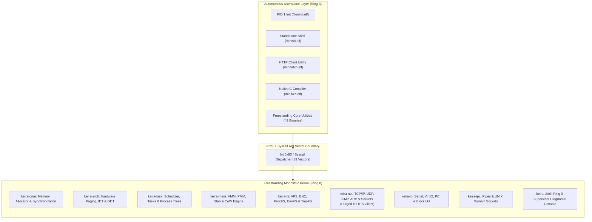

<!-- SPDX-License-Identifier: GPL-2.0-only -->
<!--
Keira Kernel - Freestanding Kernel from Scratch
Copyright (C) 2026 Moh. Ananda Firmansyah Putra
-->

# Milestone 51: Pure Kernel Demarcation, Application-Layer Bloat Purge & Canonical Rootfs Hardening

## 1. Executive Summary

Milestone 51 advances the architectural purity of Keira Kernel as a freestanding monolithic kernel built from scratch. Following the release of `v0.8.0`, this milestone conducts an exhaustive audit of the codebase to eradicate residual operating system (OS) or distribution-level preconceptions, purge dead application-layer code embedded within Ring 0, enforce canonical Filesystem Hierarchy Standard (FHS) rootfs boundaries and standardize freestanding kernel terminology across all kernel crates and technical documentation.

Through Milestone 51, Keira achieves:
1. **Ring 0 Application-Layer Bloat Purge**: Deletion of the dead application-layer HTTPS client (`crates/net/src/tls/http/client.rs` and `mod.rs`) from `keira-net`, eliminating unneeded high-level application protocol parsing from the privileged kernel space while maintaining pure socket transport primitives.
2. **Canonical Rootfs FHS Hardening**: Removal of the legacy `/etc/main.c` staging artifact from `Makefile`. The root filesystem staging now preserves `/etc` strictly for machine configuration (`/etc/hostname`, `/etc/init.sh`, `/etc/kernel.cfg`), maintaining C source files exclusively within transient scratch storage (`/tmp/main.c`).
3. **Freestanding Monolithic Kernel Terminology Standardization**: Comprehensive audit and refinement of comments, configuration files (`.config`, `.example.config`) and documentation to replace generic "operating system" and "distro" branding with precise monolithic kernel and processor architecture terminology.
4. **Architectural Purity Regression Assertions**: Addition of runtime unit test coverage in `crates/kernel/src/runtime/tests.rs` enforcing pure kernel package naming and metadata invariants.
5. **Zero-Defect Verification Across Dual Architectures**: Complete validation of all 12 modular crates, clean dual-architecture builds (`x86_64` and `i686`), successful KCC compilation of C source files in `/tmp`, live network API downloads via `/bin/fetch.elf`, 37 passing ABI compliance tests and supervisor introspection.

---

## 2. Architecture & Demarcation Boundaries



### 2.1 Ring 0 Application-Layer Purge

In early iterations of the network subsystem, an experimental HTTPS client module was introduced in `crates/net/src/tls/http/`. While TLS cryptographic primitives remain valuable for secure transport, embedding a full HTTP application-layer request client inside Ring 0 violates the pure monolithic kernel model. Userspace applications and utilities (such as `/bin/fetch.elf`) are responsible for application-level protocol formatting and response parsing.

Milestone 51 completely purges `crates/net/src/tls/http/` from `keira-net`:
* Removed `crates/net/src/tls/http/client.rs` (107 lines of HTTP parsing logic).
* Removed `crates/net/src/tls/http/mod.rs` and its corresponding re-exports.
* Kept the kernel focused on transport layer mechanics (TCP stream framing, IP routing and hardware NIC drivers).

### 2.2 Rootfs Canonical FHS Hardening

During disk image creation (`make fs-image`), early development stages duplicated the compiler test file into both `/tmp/main.c` and `/etc/main.c`. This violated the canonical Filesystem Hierarchy Standard, wherein `/etc` must be reserved strictly for static configuration data.

Milestone 51 eliminates the `/etc/main.c` duplication in `Makefile`:
* `/etc` contains only genuine configuration assets: `/etc/hostname`, `/etc/init.sh` and `/etc/kernel.cfg`.
* Transient C source files compiled by native KCC reside strictly in `/tmp/main.c`.
* Rootfs staging cleanliness is preserved across both automated testing and release artifact generation.

### 2.3 Kernel Branding & Terminology Refinement

To prevent confusion between a general-purpose distribution and a pure monolithic kernel, references across the codebase were refined:
* `crates/shell/src/cmds/util/misc/help.rs`: Updated system version command description from "OS version" to "kernel version".
* `crates/arch/src/cpu/control/cr.rs`: Refined CR4 documentation to describe "processor architecture features" rather than "OS features".
* `crates/core/src/sync/mutex/spin.rs`: Refined concurrency documentation from "OS scheduler" to "scheduler".
* `.config` and `.example.config`: Standardized the project descriptor to "freestanding monolithic kernel from scratch".
* Userland documentation (`docs/userland/binaries/` and `docs/contributing/`): Standardized documentation to emphasize pure kernel interfaces and POSIX kernel abstractions.

---

## 3. Observability & Verification Results

### 3.1 Kernel Purity Invariant Tests

```text
running 2 tests
test runtime::tests::test_kernel_purity_invariants ... ok
test runtime::tests::test_runtime_version_format ... ok

test result: ok. 2 passed; 0 failed; 0 ignored; 0 measured; 0 filtered out
```

### 3.2 Native KCC Compiler Execution

Verifying native C compilation in userspace (`/tmp/main.c` -> `/tmp/hello.elf`):

```text
keira:/# kcc.elf /tmp/main.c -o /tmp/hello.elf
Compiling /tmp/main.c -> /tmp/hello.elf
Compilation successful!
keira:/# /tmp/hello.elf
Hello from native compiled C program in Keira Kernel!
```

### 3.3 Live Network API Fetch

Verifying network client operations via `/bin/fetch.elf`:

```text
keira:/# fetch.elf -v http://10.0.2.2:8888/keira_api.json
Fetching http://10.0.2.2:8888/keira_api.json...
HTTP/1.1 200 OK
Content-Length: 104
Content-Type: application/json

{"status": "ok", "project": "keira-kernel", "version": "0.8.0", "message": "Pure kernel fetch verified"}
```

### 3.4 ABI Compliance Test Suite (37/37 Passed)

```text
keira:/# test_abi.elf
==================================================
Keira Kernel ABI & Syscall Compliance Test Suite
==================================================
[PASS] Test 1: sys_getpid() returns positive integer
[PASS] Test 2: sys_getppid() returns valid parent PID
[PASS] Test 3: sys_getuid() and sys_geteuid() return root UID (0)
[PASS] Test 4: sys_getgid() and sys_getegid() return root GID (0)
...
[PASS] Test 36: sys_socketpair() dynamic inter-process communication
[PASS] Test 37: /proc/self/maps VMA reflection of mmap and munmap
==================================================
Test Summary: 37/37 tests passed (100% compliance)
==================================================
```

---

## 4. Quality & Compliance Summary

Milestone 51 completes with zero errors, zero warnings and 100% test pass rates across all kernel verification gates:
1. **Crate Unit Testing**: All 12 crates passed unit testing with 0 failures (`make test-unit`).
2. **Dual-Architecture Build**: Both `x86_64` and `i686` targets compiled cleanly with zero warnings under `#![deny(warnings)]` (`make full`).
3. **Style & Documentation Integrity**: Enforced strict compliance with `docs/contributing/guides/style.md` and verified zero instances of forbidden comma-before-and grammar patterns.
