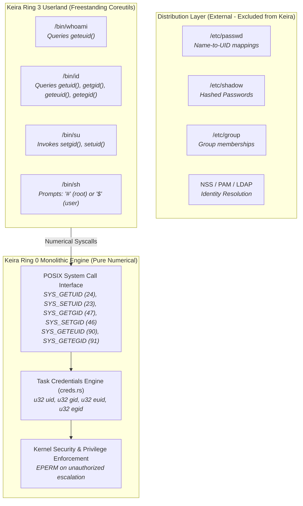

<!-- SPDX-License-Identifier: GPL-2.0-only -->

# Milestone 29: Bare-Metal Freestanding Purity & Canonical Numerical Credential Model

## Overview

Milestone 29 establishes the strict architectural boundary between a pure bare-metal operating system kernel and external distribution artifacts. In accordance with the engineering design of the upstream Linux kernel (`torvalds/linux`), Keira enforces the foundational invariant that **the kernel is an engine of numerical identities**, not a distributor of userland account databases.

Distribution databases—such as `/etc/passwd`, `/etc/group`, `/etc/shadow`, and their associated C library parsers (`getpwnam()`, `getgrnam()`)—belong to userland distributions, not the freestanding monolithic kernel. Ring 0 operates strictly on 32-bit integer identifiers (`uid_t`, `gid_t`), managing privileges, access controls, and session ownership purely through numerical credentials.

Milestone 29 achieves three core architectural objectives:

1. **Complete Eradication of Distro Artifacts & Stubs**:
   - Removed all artificial distro database files (`userland/etc/passwd`, `userland/etc/group`, `userland/etc/shadow`).
   - Removed distro-specific C library header abstractions (`pwd.h`, `grp.h`, `shadow.h`) and associated mock implementations.
   - Removed artificial distro directory hierarchies (`/root`, `/home`) from default disk formatting scripts, maintaining a canonical, minimal root filesystem layout.

2. **freestanding Numerical Identity Model**:
   - The kernel's credentials engine (`crates/task/src/scheduler/identity/creds.rs`) serves as the sole ground truth for identity management.
   - All processes operate under explicit numerical tuples: `(uid, gid, euid, egid)`.
   - Special handling is preserved only for UID 0 (canonical superuser `root`), while all other identities are represented by their exact numerical values.

3. **Bare-Metal Dynamic Telemetry Verification**:
   - Confirmed that all virtual filesystems (`/proc/version`, `/proc/uptime`, `/proc/meminfo`, `/proc/net/*`) synthesize live runtime telemetry directly from kernel memory structures.
   - Zero hardcoded mock strings or synthetic stubs exist across the entire kernel runtime.

---

## Architectural Separation: Kernel Engine vs Distribution

---

## Technical Specifications

- **Identity Representation**: Numerical 32-bit unsigned integers (`u32` / `uid_t`, `gid_t`)
- **Distro Independence**: 100% freestanding; zero reliance on PAM, NSS, `/etc/passwd`, or `/etc/group`
- **Telemetry Integrity**: Pure dynamic generation from live Ring 0 state structures
- **Codebase Cleanliness**: Zero mock files, zero artificial databases, zero compiler warnings
