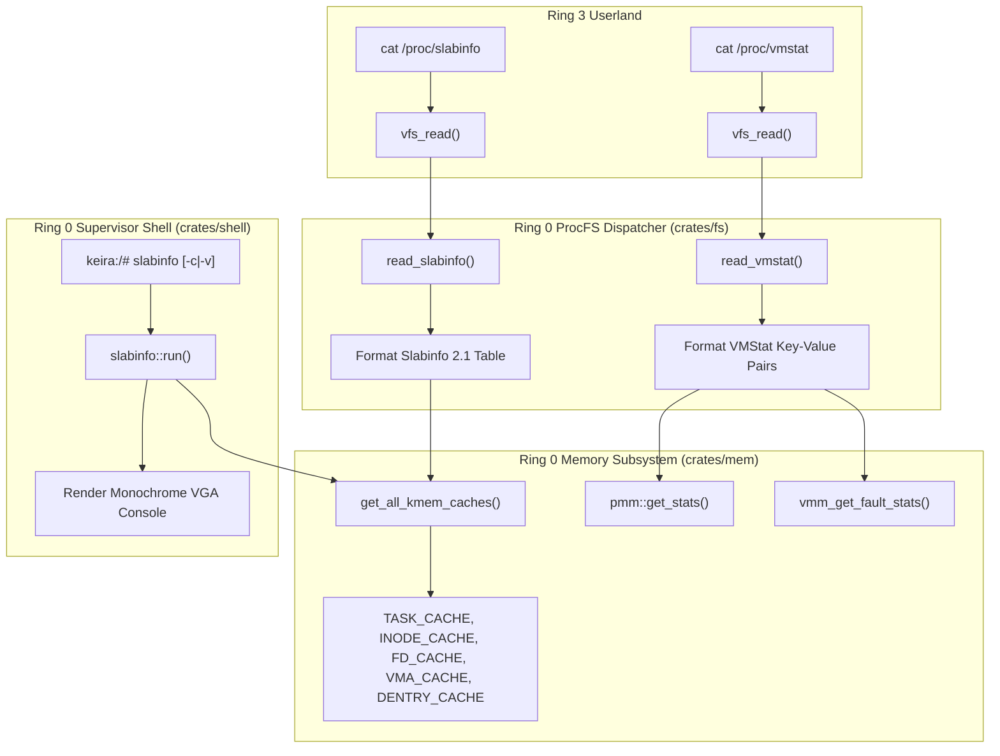

<!-- SPDX-License-Identifier: GPL-2.0-only -->

# Milestone 40: Pure Kernel Memory Introspection (/proc/slabinfo, /proc/vmstat) & Supervisor Slab Telemetry

## 1. Overview & Architectural Motivation

Milestone 40 advances Keira's kernel observability and memory accounting without introducing distribution bloat or userspace daemons. By implementing the canonical Linux `/proc/slabinfo` (version 2.1) and `/proc/vmstat` virtual pseudo-nodes, alongside a dedicated Ring 0 `slabinfo` command, the kernel gains full introspection into object caches, physical page states and virtual memory paging events:

1. **Slab Allocator Cache Registry & Telemetry (`crates/mem`)**:
   - Registers all primary kernel object caches (`task_struct`, `inode_cache`, `file_desc_cache`, `vma_cache`, `dentry_cache`) in a unified registry.
   - Exposes per-cache object metrics, physical page footprints, tunables (limit, batchcount, sharedfactor) and per-CPU core magazine telemetry.
2. **Canonical Linux ProcFS Slab & VM Nodes (`crates/fs`)**:
   - `/proc/slabinfo`: Implements the standard version 2.1 protocol consumable by standard tools like `slabtop` and userland monitoring utilities.
   - `/proc/vmstat`: Exposes kernel virtual memory counters including page faults, demand paging, COW replications, stack growths and TLB shootdown events.
3. **Supervisor Emergency Command (`slabinfo`) (`crates/shell`)**:
   - Introduces the `slabinfo` command (alias `slab`) in Ring 0 with clean monochrome Linux console styling.
   - Supports flag `-c` / `--cpu` for per-core magazine depot utilization and `-v` / `--verbose` for detailed tunables and depot cache breakdown.

---

## 2. Technical Architecture & Component Interaction

---

## 3. Implementation Details

### A. Memory Subsystem Registry (`crates/mem/src/slab/cache/manager.rs`)
- `DENTRY_CACHE`: Pre-allocated 128-byte cache for VFS directory entry descriptors.
- `ALL_KMEM_CACHES`: Static array containing all registered kernel descriptor caches.
- `objs_per_slab(&self)`: Fixed object capacity per slab based on magazine capacity (32).
- `pages_per_slab(&self)`: Dedicated frame footprint per slab (1 page / 4 KiB).
- `active_slabs(&self)` and `num_slabs(&self)`: Computed slab counts based on active and total object allocation counters.
- `cpu_stats(&self, core_id)`: Queries per-CPU core cached counts, allocation hits, free hits and depot exchanges.

### B. ProcFS Telemetry Endpoints (`crates/fs/src/proc/system/`)
- `/proc/slabinfo` (`crates/fs/src/proc/system/slabinfo.rs`):
  Outputs header `slabinfo - version: 2.1` and formatted columns for `<active_objs>`, `<num_objs>`, `<objsize>`, `<objperslab>`, `<pagesperslab>`, tunables (`<limit>`, `<batchcount>`, `<sharedfactor>`) and slabdata (`<active_slabs>`, `<num_slabs>`, `<sharedavail>`).
- `/proc/vmstat` (`crates/fs/src/proc/system/vmstat.rs`):
  Outputs key-value telemetry pairs: `nr_free_pages`, `nr_alloc_pages`, `nr_page_table_pages`, `nr_dirty`, `nr_writeback`, `nr_slab_reclaimable`, `nr_slab_unreclaimable`, `pgpgin`, `pgpgout`, `pgfault`, `pgmajfault`, `pgfault_cow`, `pgfault_stack`, `pgfault_demand`, `tlb_flushes`.

### C. Ring 0 Supervisor Command (`crates/shell/src/cmds/sys/info/slabinfo.rs`)
- `slabinfo` (alias `slab`):
  - Formats real-time slab metrics in standard Linux monochrome console palette (`White` data and `LightGrey` dividers).
  - Summary row aggregates total active objects, cached objects and total allocated slab memory.
  - `-c` flag isolates per-core magazine depot allocation hits, free hits and cross-depot exchanges.
  - `-v` flag reveals slab tunables, depot cache buffers and active versus total object ratios.
- Integrated into `crates/shell/src/executor/dispatch/router.rs` and `crates/shell/src/cmds/util/misc/help.rs`.
