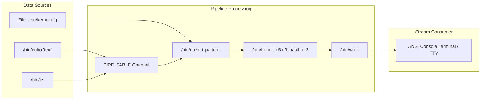

<!-- SPDX-License-Identifier: GPL-2.0-only -->

# Milestone 37: Text Processing Pipeline Suite & Kernel Memory Isolation Hardening

## Overview

Milestone 37 advances Keira Kernel towards the `v0.7.0` release by introducing a full-featured freestanding text processing pipeline suite in Ring 3 userspace (`/bin/grep`, `/bin/wc`, `/bin/head`, `/bin/tail`, `/bin/echo`, `/bin/sleep`), bringing the total canonical userland utility suite to **39 native ELF binaries**. Furthermore, Milestone 37 resolves critical kernel-space memory invariants—safeguarding against privilege stack overflow collisions and guaranteeing zeroed page table allocations across the Virtual Memory Manager (VMM) and Physical Memory Manager (PMM).

Building on Milestone 36's anonymous pipe subsystem (`PIPE_TABLE` and `SYS_PIPE2`), users and scripts in Keira can now construct complex, POSIX-compliant data processing workflows directly in memory without relying on disk-backed scratch files or host dependencies.

Key accomplishments of Milestone 37 include:

1. **Freestanding Text Processing Pipeline Suite (`userland/bin/`)**:
   Six fundamental UNIX text utilities have been engineered from first principles as unprivileged Ring 3 C executables in `userland/bin/`:
   - `/bin/grep.elf` (`/bin/grep`): Regular pattern matching utility supporting case-insensitive searching (`-i`), line numbering (`-n`), inverted match selection (`-v`), and match count aggregation (`-c`).
   - `/bin/wc.elf` (`/bin/wc`): Stream metric counter measuring newline counts (`-l`), whitespace-delimited word counts (`-w`), byte sizes (`-c`), and character lengths (`-m`).
   - `/bin/head.elf` (`/bin/head`): First lines/bytes stream head truncation utility supporting line-based slicing (`-n <lines>`), byte extraction (`-c <bytes>`), quiet mode (`-q`), and verbose file headers (`-v`).
   - `/bin/tail.elf` (`/bin/tail`): Last lines/bytes stream tail extraction utility utilizing an in-memory circular line pointer ring buffer for bounded memory consumption.
   - `/bin/echo.elf` (`/bin/echo`): String argument printing utility supporting `-n` newline suppression and `-e` escape sequence interpolation (`\n`, `\t`, `\r`, `\\`).
   - `/bin/sleep.elf` (`/bin/sleep`): Deterministic process interval suspension utility interfacing with `sys_nanosleep` and supporting time suffixes (`s`, `m`, `h`, `d`).

2. **Kernel Privilege Stack Hardening & Collision Prevention**:
   - Discovered that an initial single 4 KiB allocation for `BOOT_KERNEL_STACK_TOP` in `crates/syscall/src/tss/privilege/init.rs` caused nested VFS and sector caching call chains in `sh.elf` to expand down into adjacent physical memory frames (specifically colliding with frame `0x6a6000`, the e1000 network driver Page Table).
   - Expanded `BOOT_KERNEL_STACK_TOP` to 8 contiguous pages (32 KiB) via `pmm::alloc_contiguous_frames(8)`.
   - Allocated a dedicated 16 KiB kernel stack (`TASK_STACK_PAGES = 4`) for Task 0 (`kernel_shell`) in `crates/task/src/scheduler/core/state.rs`.

3. **VMM Page Table Zeroing & Canonical Boot PML4 Root**:
   - Enforced strict memory zeroing (`core::ptr::write_bytes`) for all newly allocated PDPT, PD, and PT frames in `map_page_in_pml4` and `map_huge_2m_page`.
   - Initialized `BOOT_PML4_PHYS` in `crates/mem` to record the pristine kernel boot PML4, ensuring child processes cloned via `clone_kernel_pml4()` inherit immaculate kernel and MMIO mappings.
   - Explicitly marked frames `0..aligned_kernel_end` as allocated in `ALLOCATION_BITMAP` to safeguard low memory and kernel ELF image code/data against allocator fallback reuse.

4. **Hardware Verification of Networking & Native Compilation**:
   - Verified 100% successful ICMP reachability (`ping -c 2 10.0.2.2`) with 0% packet loss and zero kernel page faults.
   - Verified HTTP network retrieval (`fetch -v http://10.0.2.2:8080/api/status`) receiving API payloads over TCP sockets.
   - Verified native C compilation inside the kernel using `kcc` (`kcc -o /tmp/app.elf /tmp/main.c`) and clean Ring 3 execution of the resulting binary.

---

## Architectural Data Flow: Text Processing Pipeline

---

## Userland Suite Expansion Summary

With the introduction of Milestone 37, Keira's userspace core utilities encompass 39 native executables:

| Category | Binaries |
| :--- | :--- |
| **System Init & Shell** | `init.elf`, `sh.elf` |
| **File & Directory Management** | `cat.elf`, `ls.elf`, `mkdir.elf`, `touch.elf`, `rm.elf`, `ln.elf` |
| **Text Processing & Pipelines** | `grep.elf`, `wc.elf`, `head.elf`, `tail.elf`, `echo.elf`, `sleep.elf` |
| **Process & Session Management** | `ps.elf`, `kill.elf`, `whoami.elf`, `id.elf`, `su.elf` |
| **System & Storage Observability** | `hostname.elf`, `clear.elf`, `dmesg.elf`, `df.elf`, `sysinfo.elf`, `uname.elf` |
| **Filesystem & Mount Operations** | `mount.elf`, `umount.elf` |
| **Network & Firewall Diagnostics** | `fetch.elf`, `ping.elf`, `ifconfig.elf`, `route.elf`, `arp.elf`, `netstat.elf`, `iptables.elf` |
| **Developer Toolchain & Testing** | `kcc.elf`, `test_abi.elf`, `fuzz_abi.elf`, `test_threads.elf`, `test_pipe.elf` |

---

## Symmetrical Dual-Architecture Verification

All 39 binaries, the userland runtime library (`libc.a`), and the monolithic kernel compile cleanly with 0 errors and 0 warnings on both `x86_64` (64-bit Long Mode) and `i686` (32-bit Protected Mode).
