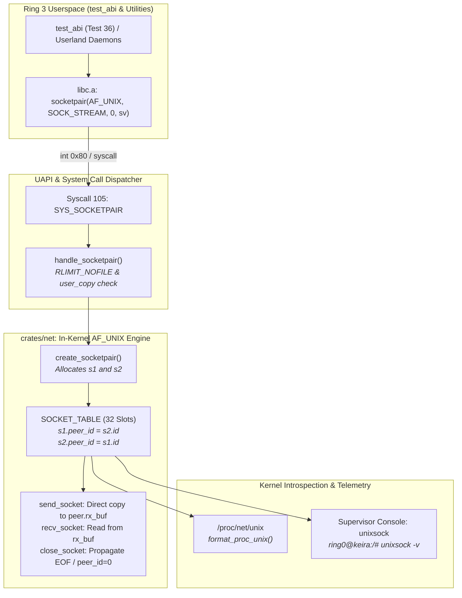

<!-- SPDX-License-Identifier: GPL-2.0-only -->

# Milestone 47: UNIX Domain Sockets (AF_UNIX & SYS_SOCKETPAIR), /proc/net/unix Telemetry, Supervisor unixsock Diagnostics & Kernel Decoupling

## 1. Overview & Architectural Motivation

Milestone 47 delivers native, high-performance in-kernel **UNIX Domain Sockets (`AF_UNIX`)** and Century-Plus System Call 105 (`SYS_SOCKETPAIR`) to the Keira freestanding monolithic operating system. Building upon the process resource limits and sandbox quotas established in Milestone 46, Milestone 47 enables bidirectional inter-process communication (IPC) through in-memory kernel ring buffers without traversing the TCP/IP network stack, hardware drivers, or packet framing layers.

Furthermore, Milestone 47 strictly reinforces Keira's **Torvalds-Grade Pure Kernel Demarcation** (`CONFIG_USERLAND=y` vs `CONFIG_USERLAND=n`):
- The Ring 0 kernel owns the socket buffers, peer endpoint coupling, procfs reflection (`/proc/net/unix`), and supervisor telemetry (`unixsock`).
- Ring 3 userland provides autonomous verification through libc wrappers and `test_abi`, remaining completely optional and decoupled.
- The kernel boot sequence is purified of lingering `/etc/hostname` filesystem reads, enforcing pure freestanding boot behavior.

Milestone 47 delivers five primary achievements:

1. **In-Kernel UNIX Domain Sockets & Peer Coupling (`crates/net`)**:
   - Extends the kernel `SocketEntry` descriptor with `peer_id: u32`, bound pathname `path: [u8; UNIX_PATH_MAX]`, and path length metadata.
   - Implements zero-copy stream transfers in `send_socket`: writes to a connected UNIX domain socket copy data directly into the peer endpoint's receive buffer (`peer.rx_buf`), bypassing all network driver queues.
   - Enforces POSIX stream semantics: closing an endpoint notifies the peer, causing subsequent peer reads to return `0` (EOF) and subsequent peer writes to fail with broken pipe (`EPIPE`).
2. **Century-Plus System Call 105: `SYS_SOCKETPAIR` (`crates/syscall`)**:
   - Assigns official system call number 105 (`SYS_SOCKETPAIR`) with Linux i386 compatibility vector alias 360.
   - Atomically allocates two socket descriptors, connects their peer IDs, and allocates two file descriptors in the calling task's descriptor table.
   - Enforces `RLIMIT_NOFILE` quota limits and validates user destination pointer with `validate_user_ptr`.
3. **Virtual ProcFS Network Telemetry (`/proc/net/unix`)**:
   - Synthesizes `/proc/net/unix` conforming to canonical Linux formatting:
     `Num       RefCount Protocol Flags    Type St Inode Path`
   - Formats active socket IDs, types (`SOCK_STREAM`), connection states, and pathnames or `[socketpair]` designations.
4. **Ring 0 Supervisor Console Diagnostics (`unixsock`)**:
   - Introduces `unixsock` (alias `unix`) to the emergency supervisor monitor.
   - Displays active UNIX domain sockets, connection states, peer IDs, buffer occupancy ratios (`rx_len/SOCKET_BUF_SIZE`), and bound pathnames.
   - Supports `-v` (verbose) mode displaying transmit queue metrics and connection flags.
5. **Autonomous Userland Verification & UAPI Header Export**:
   - Introduces `userland/include/sys/un.h` declaring `struct sockaddr_un` and `AF_UNIX`.
   - Exports UAPI headers via `make headers_install` to `include/uapi/sys/un.h`.
   - Adds Test 36 to `userland/bin/test_abi/ipc/tests.c` validating bidirectional `socketpair` communication, buffer isolation, peer closure EOF semantics, and invalid domain error handling.

---

## 2. Technical Architecture & Component Interaction



---

## 3. In-Kernel Socket Table & Stream Mechanics

### 3.1 Socket Descriptor Extension

In [`crates/net/src/socket/handle/descriptor.rs`](../../crates/net/src/socket/handle/descriptor.rs), `SocketEntry` is enhanced with peer coupling and pathname metadata:

```rust
pub const MAX_SOCKETS: usize = 32;
pub const SOCKET_BUF_SIZE: usize = 2048;
pub const UNIX_PATH_MAX: usize = 108;

#[derive(Clone, Copy, Debug)]
pub struct SocketEntry {
    pub id: u32,
    pub domain: u32,
    pub socket_type: u32,
    pub protocol: u32,
    pub state: TcpState,
    pub nonblocking: bool,
    pub local_ip: [u8; 4],
    pub remote_ip: [u8; 4],
    pub local_port: u16,
    pub remote_port: u16,
    pub rx_buf: [u8; SOCKET_BUF_SIZE],
    pub rx_len: usize,
    pub tx_buf: [u8; SOCKET_BUF_SIZE],
    pub tx_len: usize,
    pub in_use: bool,
    pub is_connected: bool,
    pub peer_id: u32,
    pub path: [u8; UNIX_PATH_MAX],
    pub path_len: usize,
}
```

### 3.2 Bidirectional Zero-Copy Streaming

When a process writes data into a connected UNIX domain socket descriptor, `send_socket` inspects `slot.peer_id` and copies the user payload directly into `peer.rx_buf`:

```rust
if is_unix {
    if !is_connected || peer_id == 0 {
        return Err("Socket is not connected");
    }
    for peer in SOCKET_TABLE.iter_mut() {
        if peer.in_use && peer.id == peer_id {
            let avail = SOCKET_BUF_SIZE.saturating_sub(peer.rx_len);
            let to_write = core::cmp::min(len, avail);
            if to_write > 0 {
                let dst = peer.rx_buf.as_mut_ptr().add(peer.rx_len);
                core::ptr::copy_nonoverlapping(buf, dst, to_write);
                peer.rx_len += to_write;
                return Ok(to_write);
            } else {
                return Err("Peer receive buffer full");
            }
        }
    }
    return Err("Broken pipe");
}
```

---

## 4. System Call Vector 105: `SYS_SOCKETPAIR`

Native system call vector 105 is registered in [`crates/syscall/src/table/numbers/net.rs`](../../crates/syscall/src/table/numbers/net.rs) and mapped in [`crates/syscall/src/dispatcher/router/entry.rs`](../../crates/syscall/src/dispatcher/router/entry.rs):

```rust
pub const SYS_SOCKETPAIR: u64 = 105;
```

The handler in [`crates/syscall/src/dispatcher/handlers/net.rs`](../../crates/syscall/src/dispatcher/handlers/net.rs) guarantees memory safety, quota enforcement, and clean rollback on fault:

```rust
pub fn handle_socketpair(domain: u64, socket_type: u64, protocol: u64, sv_ptr: u64) -> u64 {
    unsafe {
        if let Err(e) = validate_user_ptr(sv_ptr, 8, true) {
            return errno_to_ret(e);
        }

        let task = &mut TASKS[CURRENT_TASK_IDX];
        if let Some(t) = task {
            let max_open_limit =
                (t.rlimits[keira_task::rlimit::RLIMIT_NOFILE].cur as usize).min(MAX_FDS);

            let mut free_fds = [None, None];
            let mut found = 0;
            for i in 3..max_open_limit {
                if !t.fds[i].is_open {
                    free_fds[found] = Some(i);
                    found += 1;
                    if found == 2 {
                        break;
                    }
                }
            }

            if found < 2 {
                return errno_to_ret(EMFILE);
            }

            let fd1 = free_fds[0].unwrap();
            let fd2 = free_fds[1].unwrap();

            match keira_net::socket::create_socketpair(domain, socket_type, protocol) {
                Ok((sock1_id, sock2_id)) => {
                    t.fds[fd1] = FileDescriptor::new_socket(sock1_id as u32, false);
                    t.fds[fd2] = FileDescriptor::new_socket(sock2_id as u32, false);

                    let fds: [i32; 2] = [fd1 as i32, fd2 as i32];
                    let fds_bytes = core::slice::from_raw_parts(fds.as_ptr() as *const u8, 8);
                    if copy_to_user(sv_ptr, fds_bytes).is_err() {
                        let _ = keira_net::socket::close_socket(sock1_id);
                        let _ = keira_net::socket::close_socket(sock2_id);
                        t.fds[fd1] = FileDescriptor::new();
                        t.fds[fd2] = FileDescriptor::new();
                        return errno_to_ret(EFAULT);
                    }
                    0
                }
                Err("Domain not supported") => errno_to_ret(EAFNOSUPPORT),
                Err("Socket type not supported") => errno_to_ret(EPROTONOSUPPORT),
                Err(_) => errno_to_ret(ENFILE),
            }
        } else {
            errno_to_ret(ESRCH)
        }
    }
}
```

---

## 5. Telemetry & Diagnostics

### 5.1 ProcFS Virtual Reflection (`/proc/net/unix`)

Exposed dynamically at `/proc/net/unix`, reporting in canonical Linux format:

```text
Num       RefCount Protocol Flags    Type St Inode Path
00000001: 00000002 00000000 00010000 0001 03     0 [socketpair]
00000002: 00000002 00000000 00010000 0001 03     0 [socketpair]
```

### 5.2 Supervisor Console (`unixsock`)

Available directly from the Ring 0 emergency monitor (`ring0@keira:/# unixsock -v`):

```text
=== Active UNIX Domain Sockets (AF_UNIX IPC Table) ===

ID   Type     State        Peer   RX Queue     TX Queue     Path / Role
---- -------- ------------ ------ ------------ ------------ --------------------
1    STREAM   CONNECTED    2      0/2048B      0/2048B      [socketpair]
2    STREAM   CONNECTED    1      0/2048B      0/2048B      [socketpair]
```

---

## 6. Verification Results

| Test Target | Verification Command | Status | Notes |
| :--- | :--- | :--- | :--- |
| **Workspace Unit Tests** | `make test-unit` | **PASSED** | 35 net tests, 51 shell tests, 55 fs tests, 32 task tests |
| **Autonomous Userland (x86_64)** | `make -C userland all ARCH=x86_64` | **PASSED** | 41 binaries compiled and linked cleanly |
| **Autonomous Userland (i686)** | `make -C userland all ARCH=i686` | **PASSED** | Symmetrical 32-bit userland build passed |
| **Pure Ring 0 Kernel (x86_64)** | `make pure_defconfig && make kernel` | **PASSED** | Freestanding Ring 0 kernel built without userland |
| **Pure Ring 0 Kernel (i686)** | `make pure_defconfig ARCH=i686 && make kernel ARCH=i686` | **PASSED** | Symmetrical 32-bit pure kernel build passed |
| **Full Decoupled OS (x86_64)** | `make defconfig && make all` | **PASSED** | ISO, FAT16 disk, initrd, UAPI headers all built |
| **ABI Verification (Test 36)** | `/bin/test_abi` in QEMU | **PASSED** | `socketpair` bidirectional streaming, EOF and errno validated |

