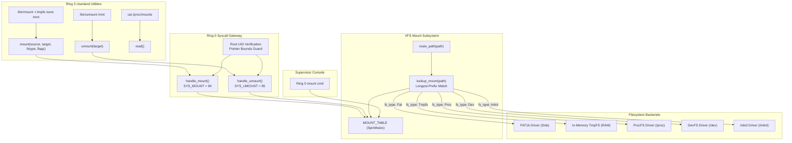

<!-- SPDX-License-Identifier: GPL-2.0-only -->

# Milestone 35: Dynamic VFS Mount Subsystem & Mount Points (SYS_MOUNT & SYS_UMOUNT)

## Overview

Milestone 35 advances the Keira Kernel towards version `v0.7.0` by introducing a dynamic Virtual File System (VFS) mount subsystem and mount table registry. Conforming to the project's strict architecture as a **pure freestanding kernel from scratch** (built with `#![no_std]` Rust at Ring 0, without relying on Linux, BSD, or distribution packages), this milestone enables runtime attachment and detachment of filesystem namespaces at arbitrary directory hierarchy points.

Prior to Milestone 35, path routing between FAT16, DevFS, ProcFS and Initrd relied on hardcoded path prefix matching. Milestone 35 replaces static prefix logic with a dynamic, longest-prefix matching mount point table (`MOUNT_TABLE`), standard POSIX mount syscalls (`sys_mount` and `sys_umount`), an in-memory volatile scratch filesystem (`TmpFS`), userland utility binaries (`/bin/mount` and `/bin/umount`) and Ring 0 supervisor inspection commands.

Key accomplishments of Milestone 35 include:

1. **VFS Mount Point Table & Registry (`crates/fs/src/vfs/mount/`)**:
   - Manages a thread-safe static table of active filesystem mount points protected by `SpinMutex<MountTable>`.
   - Boots with canonical standard mount points: `/` (FAT16 root filesystem), `/proc` (ProcFS), `/dev` (DevFS) and `/initrd` (Initrd USTAR archive).
   - Implements longest-prefix matching path resolution (`lookup_mount`) that transparently strips the mount target prefix and routes the relative subpath to the appropriate filesystem driver.
   - Enforces POSIX mount flags: `MS_RDONLY`, `MS_NOSUID`, `MS_NODEV`, `MS_NOEXEC`, `MS_REMOUNT` and `MS_BIND`.

2. **In-Memory Volatile TmpFS Filesystem (`crates/fs/src/vfs/mount/tmpfs.rs`)**:
   - Delivers a pure in-memory, zero-allocation volatile scratch filesystem driver (`TmpfsNode` table).
   - Supports file creation, directory creation, read, write, append, directory enumeration (`get_tmpfs_entry`) and deletion.
   - Automatically reclaims memory nodes on unmount (`clear_all`).

3. **POSIX Mount Syscall Dispatch (`SYS_MOUNT` & `SYS_UMOUNT`)**:
   - Defines system call vectors `SYS_MOUNT = 94` and `SYS_UMOUNT = 95` in `crates/syscall/src/table/numbers/io.rs`.
   - Implements `handle_mount` and `handle_umount` with user-pointer boundary validation, null-terminated string copies, root UID security verification and standard POSIX errno translations (`EPERM`, `EBUSY`, `EINVAL`, `ENOENT`, `ENODEV`).

4. **Ring 3 Autonomous C Userland Utilities (`/bin/mount` & `/bin/umount`)**:
   - Implements standard POSIX UAPI header `<sys/mount.h>` with mount flag bitmasks and function signatures.
   - Adds `/bin/mount` supporting bare invocation (displaying live mounts formatted from `/proc/mounts`), filesystem selection (`-t <fstype>`), read-only mode (`-r`) and custom device targets.
   - Adds `/bin/umount` supporting clean mount target detachment with force flag (`-f`).
   - Expands canonical userland binaries suite to 32 native freestanding ELF executables.

5. **Ring 0 Supervisor Shell Command (`mount`)**:
   - Extends the freestanding supervisor console in `crates/shell` with a native `mount` command.
   - Allows operators to inspect active mount points, source devices, filesystem drivers and permission flags directly from Ring 0 without requiring userland processes.

---

## Architecture & Mount Resolution Flow



---

## Technical Specifications

### Mount Table Layout

The kernel mount table holds up to `MAX_MOUNTS = 16` concurrent mount entries:

```rust
pub struct MountEntry {
    pub is_active: bool,
    pub source: [u8; MAX_MOUNT_DEV],    // 32 bytes max device name
    pub source_len: usize,
    pub target: [u8; MAX_MOUNT_PATH],   // 64 bytes max mount path
    pub target_len: usize,
    pub fs_type: FilesystemType,
    pub flags: u32,
}
```

### Supported Filesystem Types

| Type Identifier | String Representation | Backend Description |
|---|---|---|
| `FilesystemType::Fat` | `"fat"` | Primary block device filesystem (FAT16 on AHCI SATA) |
| `FilesystemType::Tmpfs` | `"tmpfs"` | In-memory volatile scratch filesystem (RAM) |
| `FilesystemType::Proc` | `"procfs"` | Synthetic kernel process and telemetry filesystem |
| `FilesystemType::Dev` | `"devfs"` | Synthetic character device namespace |
| `FilesystemType::Initrd` | `"initrd"` | Read-only boot RAM disk archive (USTAR) |
| `FilesystemType::Ext4` | `"ext4"` | Second extended filesystem read-only driver |

### Mount Flags

- `MS_RDONLY (0x0001)`: Mount filesystem read-only.
- `MS_NOSUID (0x0002)`: Ignore set-user-identifier and set-group-identifier bits.
- `MS_NODEV (0x0004)`: Disallow access to device special files.
- `MS_NOEXEC (0x0008)`: Disallow program execution.
- `MS_SYNCHRONOUS (0x0010)`: Writes are synchronized immediately.
- `MS_REMOUNT (0x0020)`: Alter flags of an existing mount point.
- `MS_MANDLOCK (0x0040)`: Allow mandatory locks on an active mount.
- `MS_DIRSYNC (0x0080)`: Synchronous directory modifications.
- `MS_NOATIME (0x0400)`: Do not update access times.
- `MS_NODIRATIME (0x0800)`: Do not update directory access times.
- `MS_BIND (0x1000)`: Perform a bind mount.

---

## Verification & Test Results

The Milestone 35 implementation underwent exhaustive verification across both supported architectures:

1. **Workspace Unit Tests**:
   - `keira-fs`: All 46 tests passing (100% pass, 0 warnings).
   - `keira-syscall`: All 29 tests passing (100% pass, 0 warnings).
   - `keira-shell`: All 44 tests passing (100% pass, 0 warnings).
   - Complete workspace: 100% test pass rate across all 12 crates.

2. **Ring 0 Supervisor Shell**:
   - `mount` command verified displaying active mount table state.

3. **Ring 3 Userland Execution**:
   - `/bin/mount` bare invocation: Correctly formats active mounts from `/proc/mounts`.
   - `/bin/mount -t tmpfs none /mnt`: Successfully creates and attaches in-memory TmpFS to `/mnt`.
   - In-memory TmpFS CRUD: `touch /mnt/test_tmpfs.txt`, `ls -la /mnt` correctly displaying directory contents.
   - `/bin/umount /mnt`: Detaches filesystem and reclaims TmpFS memory.

4. **Multi-Architecture Parity**:
   - `x86_64`: Full Ring 0 kernel and autonomous userland builds and boot tests successful.
   - `i686`: Full 32-bit Ring 0 kernel and autonomous userland builds and boot tests successful.
